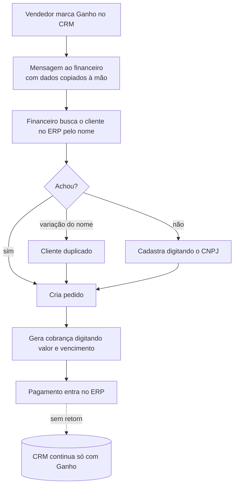
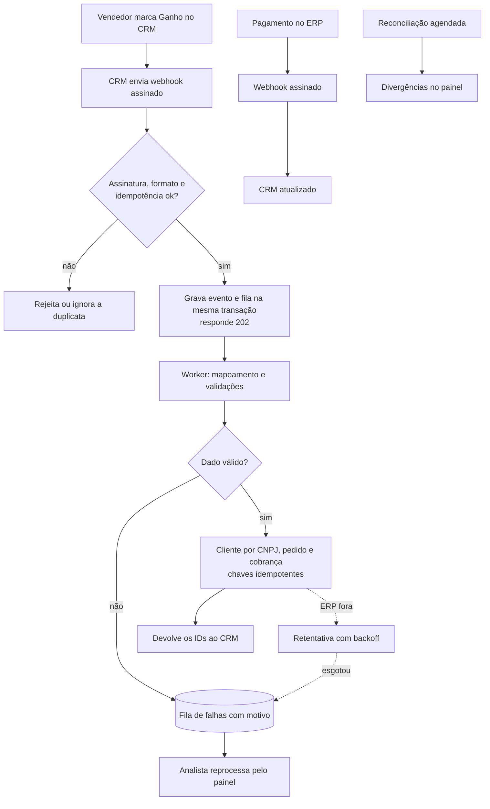
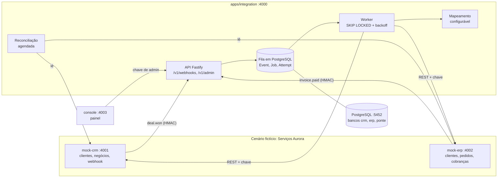
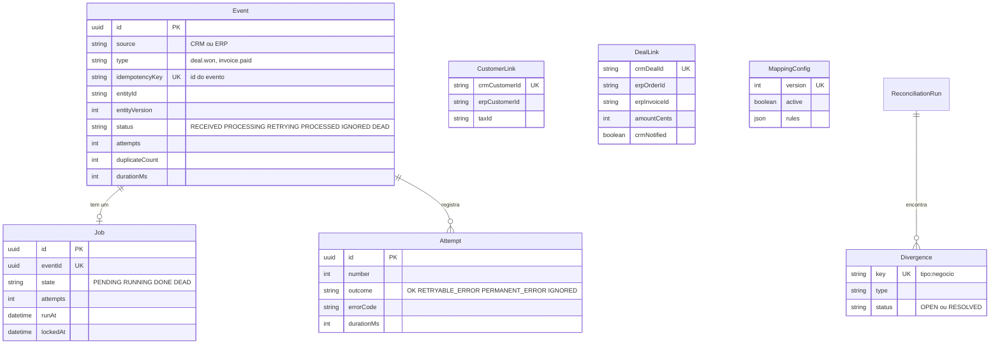

# Ponte

**Integração entre CRM e ERP com idempotência, retentativa, fila de falhas e reconciliação. Um estudo de caso de implantação que roda local.**

| CRM: negócio ganho | ERP: cobranças criadas pela Ponte | Painel de integração |
|---|---|---|
|  |  |  |

> **O que é real e o que é cenário.** O código, os testes, os contratos e os resultados registrados são reais e rodam localmente. A *Serviços Aurora*, as pessoas, os clientes e os dados são **fictícios**. O CRM e o ERP são **sistemas simples que eu criei neste repositório** (`apps/mock-crm` e `apps/mock-erp`); não são produtos comerciais. As reuniões de discovery, aceitação e retrospectiva foram **simuladas** (o Claude interpretou o cliente). Não existe cliente real, operação real nem produção, e nada foi publicado em servidor. Os ganhos esperados são hipóteses, não medições.

Sou o **João Gabriel Maia da Costa**, graduando em Engenharia de Software (PUC Minas) e desenvolvedor full stack (JavaScript/TypeScript, Node.js, PostgreSQL, Prisma). Este repositório é a minha vitrine para vagas de Analista de Implantação, Consultor de Soluções, Consultor de Automação e Analista de Automação.

## Resumo

1. A Ponte recebe o evento "negócio ganho" de um CRM e cria ou atualiza o cliente (por CNPJ, sem duplicar), o pedido e a cobrança em um ERP, devolvendo os identificadores ao CRM.
2. Quando a cobrança é paga no ERP, o CRM é atualizado; uma reconciliação agendada compara os dois lados e aponta divergências.
3. O diferencial é a engenharia da integração: **idempotência em três camadas, retentativa com backoff, fila de falhas com reprocessamento, reconciliação**, contratos OpenAPI e observabilidade.
4. Em uma execução registrada: **193 testes Vitest e 10 E2E passando**, 44 de 44 operações dos contratos cobertas e um teste que derruba o ERP de verdade no meio de um lote de 20 negócios, terminando com 20 de 20 processados e nenhuma duplicidade.
5. Cada decisão tem contexto, alternativas, escolha, motivo, trade-off e "quando eu mudaria de ideia"; o que deu errado no caminho está registrado, inclusive meus erros.

## Como o discovery foi feito

Não tive um cliente para entrevistar, então **simulei**: o Claude interpretou três pessoas da Serviços Aurora, uma empresa fictícia de 25 pessoas que usa um CRM e um ERP separados e redigita os dados à mão. Cada registro simulado começa com o aviso `> Simulação: o Claude interpretou o cliente nesta conversa.`

A simulação foi desenhada para provocar o que um discovery real provoca: uma **contradição** (o comercial quer rapidez, o financeiro quer conferência), **pedidos vagos** que eu refinei ("na hora" virou "até 5 minutos") e uma **restrição que muda o escopo** (o ERP fica fora do ar 2 h por dia e não reenvia webhooks perdidos, o que derrubou o processamento síncrono e tornou a reconciliação obrigatória). O que ela **não** faz é validar o produto com uma pessoa de verdade; está dito como limitação.

O **CRM simples** e o **ERP simples** foram criados por mim com os campos e as divergências típicas de dois sistemas distintos (CNPJ com máscara de um lado e 14 dígitos do outro, valor em texto pt-BR contra centavos inteiros, telefone livre contra E.164). Têm API REST, webhook assinado, telas básicas e, no ERP, um modo de falha para a demonstração.

## Mapa do repositório

| Pasta | O que tem | Link |
|---|---|---|
| `apps/integration` | **A Ponte**: webhooks assinados, mapeamento, fila em PostgreSQL, worker, retentativa, reconciliação, API administrativa | [apps/integration](apps/integration) |
| `apps/mock-crm` | CRM simples: clientes, negócios, etapas, webhook ao marcar "Ganho" | [apps/mock-crm](apps/mock-crm) |
| `apps/mock-erp` | ERP simples: clientes, pedidos e cobranças, idempotência por `externalRef`, modo de falha | [apps/mock-erp](apps/mock-erp) |
| `apps/console` | Painel de integração: eventos, fila de falhas, divergências, mapeamento, catálogo de erros, alertas | [apps/console](apps/console) |
| `packages/shared` | HMAC, validação de CNPJ, catálogo de erros, schemas de evento, helpers HTTP | [packages/shared](packages/shared) |
| `tests/` | Integração, contrato e falha injetada (Vitest) | [tests](tests) |
| `e2e/` | Roteiro Playwright que dirige as telas e gera os prints | [e2e](e2e) |
| `scripts/` | Cenários de demonstração, gravação dos testes, geradores de documentação | [scripts](scripts) |
| `docs/00-sobre-este-caso` | O que é real e o que é cenário | [abrir](docs/00-sobre-este-caso/README.md) |
| `docs/01-discovery` | Alternativas, negócio, 3 reuniões simuladas, AS-IS/TO-BE, mapa de dados | [abrir](docs/01-discovery/01-brainstorm-e-matriz-de-decisao.md) |
| `docs/02-definicao` | Requisitos, regras de negócio, histórias, backlog, riscos, rastreabilidade | [abrir](docs/02-definicao/01-requisitos.md) |
| `docs/03-arquitetura` | Visão geral, modelo de dados, sequências, modos de falha, 12 ADRs | [abrir](docs/03-arquitetura/01-visao-geral.md) |
| `docs/04-contratos-de-api` | 3 OpenAPI, exemplos, política de versão, catálogo de erros | [abrir](docs/04-contratos-de-api/README.md) |
| `docs/05-qualidade` | Estratégia e resultados de teste, falha injetada, aceitação, problemas, revisões de sprint | [abrir](docs/05-qualidade/README.md) |
| `docs/06-pos-lancamento` | Retrospectivas, roadmap, changelog, PR da v1.1, guia de operação | [abrir](docs/06-pos-lancamento/retrospectiva.md) |
| `docs/entrevista`, `docs/vitrine` | Perguntas por fase; bullets de currículo, post, respostas de 30 s e 2 min | [entrevista](docs/entrevista/README.md) · [vitrine](docs/vitrine/curriculo-bullets.md) |
| `docs/screenshots` | 16 prints numerados, gerados pelo sistema | [abrir](docs/screenshots) |

Índice completo de documentos: [docs/INDEX.md](docs/INDEX.md).

## Roteiro de leitura em 7 passos

1. **Discovery:** [matriz de decisão](docs/01-discovery/01-brainstorm-e-matriz-de-decisao.md) → [o negócio](docs/01-discovery/02-negocio-aurora.md) → reuniões [1](docs/01-discovery/03-reuniao-1-gerente-comercial.md), [2](docs/01-discovery/04-reuniao-2-analista-financeira.md) e [3](docs/01-discovery/05-reuniao-3-responsavel-de-ti.md) → [AS-IS e TO-BE](docs/01-discovery/06-as-is-to-be.md) → [mapa de dados](docs/01-discovery/07-mapa-de-dados.md).
2. **Requisitos:** [RF e RNF](docs/02-definicao/01-requisitos.md), [regras de negócio](docs/02-definicao/03-regras-de-negocio.md), [histórias e MoSCoW](docs/02-definicao/02-historias-e-moscow.md), [riscos](docs/02-definicao/05-riscos.md), [rastreabilidade](docs/02-definicao/07-rastreabilidade.md).
3. **Decisões:** os [12 ADRs](docs/03-arquitetura/adr); comece por [idempotência](docs/03-arquitetura/adr/ADR-003-idempotencia.md), [retentativa](docs/03-arquitetura/adr/ADR-004-retentativa-com-backoff.md) e [reconciliação](docs/03-arquitetura/adr/ADR-006-reconciliacao.md).
4. **Diagramas de sequência:** [fluxo feliz e fluxos de falha](docs/03-arquitetura/03-diagramas-de-sequencia.md) e [modos de falha](docs/03-arquitetura/04-modos-de-falha.md).
5. **Contratos de API:** [índice e política de versão](docs/04-contratos-de-api/README.md), os OpenAPI ([CRM](docs/04-contratos-de-api/crm.openapi.yaml), [ERP](docs/04-contratos-de-api/erp.openapi.yaml), [Ponte](docs/04-contratos-de-api/ponte.openapi.yaml)), [exemplos](docs/04-contratos-de-api/exemplos.md) e o [catálogo de erros](docs/04-contratos-de-api/catalogo-de-erros.md).
6. **Qualidade:** [estratégia e resultados](docs/05-qualidade/README.md), [falha injetada](docs/05-qualidade/falha-injetada.md), [problemas que encontrei](docs/05-qualidade/bugs-e-aprendizados.md), [aceitação simulada](docs/05-qualidade/reuniao-de-aceitacao.md).
7. **Evolução:** [retrospectiva](docs/06-pos-lancamento/retrospectiva.md) → [PR da v1.1](docs/06-pos-lancamento/pr-v1.1.md) → [changelog](docs/06-pos-lancamento/CHANGELOG.md) → [roadmap](docs/06-pos-lancamento/roadmap.md) → [minha retrospectiva final](docs/06-pos-lancamento/retrospectiva-final.md).

## A venda, do fechamento ao financeiro

**Antes** (sem integração): a informação passa por mensagens e digitação, e ninguém avisa o CRM.



**Depois** (com a Ponte): o evento é gravado antes de qualquer coisa, falhas viram estado e o que não dá para garantir por evento é comparado.



## Tour pelo sistema

Cada tela abaixo é um print gerado pelo próprio sistema (Playwright dirigindo as telas reais, sobre bancos limpos).

### CRM simples: marcar "Ganho" e ver o retorno do ERP


O vendedor marca o negócio como **Ganho**; o CRM envia o webhook `deal.won` e, alguns instantes depois, a tela mostra o status da cobrança e os IDs do ERP, **preenchidos pela Ponte**. *Decisão:* o CRM envia uma vez e registra a entrega; se a Ponte estava fora, a entrega fica como falha e pode ser reenviada com o mesmo id de evento, o que a idempotência torna seguro.

### ERP simples: cobranças, pedidos e clientes criados


A cobrança de R$ 58.000,00 nasceu **em conferência** (regra RN-06: a partir de R$ 50.000,00 o financeiro libera antes de poder receber pagamento). *Decisão:* resolve a contradição entre comercial (rapidez) e financeiro (conferência) com uma regra explícita, em vez de escolher um dos lados. Os [pedidos](docs/screenshots/03-erp-pedidos-criados.png) mostram a `externalRef`, a chave de idempotência; os [clientes](docs/screenshots/04-erp-clientes-criados.png) mostram o CNPJ em 14 dígitos e o telefone já convertido (`5531998765432`).

### Pagamento: o CRM aprende que foi pago


Depois da baixa no ERP, o webhook `invoice.paid` chega à Ponte e o CRM passa a **Pago**. *Decisão:* o ERP é a fonte de verdade do status da cobrança.

### Painel: visão geral


Eventos recebidos, processados, em retentativa, na fila de falhas, duplicatas descartadas, tempo médio e divergências. O tempo é do recebimento até a conclusão, incluindo fila e retentativas. *Decisão:* o painel só mostra e aciona pela API administrativa; a chave de administração fica no servidor do painel ([ADR-010](docs/03-arquitetura/adr/ADR-010-fastify-vs-next.md)).

### ERP fora: evento em retentativa


O ERP é colocado em modo de falha (o modo que simula a janela de backup), um negócio é ganho e o evento fica **em retentativa**: cada tentativa registrada, com o erro e a hora da próxima. *Decisão:* falha temporária (rede, timeout, 5xx, 429) é retentada com **backoff exponencial e jitter**; falha permanente não ([ADR-004](docs/03-arquitetura/adr/ADR-004-retentativa-com-backoff.md)).

### Fila de falhas e reprocessamento


Dois eventos: um com **CNPJ inválido** (erro de dado, direto para a fila, sem retentativa) e um que **esgotou as tentativas** com o ERP fora. Cada um mostra o código, a causa e a ação recomendada. Depois que o ERP volta, **Reprocessar** conclui o evento e o histórico mostra as 5 falhas e o sucesso. *Decisão:* o reprocessamento é manual e reaproveita as mesmas chaves, então não duplica; reprocessar automaticamente um erro de dado só repetiria o erro ([ADR-005](docs/03-arquitetura/adr/ADR-005-fila-de-falhas.md)).

### Reconciliação: o que está diferente entre CRM e ERP


O valor do negócio mudou no CRM depois que o pedido existia, e um negócio ganho está parado na fila de falhas. *Decisão:* a reconciliação **detecta e não corrige em silêncio**; só o status da cobrança tem correção assistida ([ADR-006](docs/03-arquitetura/adr/ADR-006-reconciliacao.md)).

### Mapeamento de campos e catálogo de erros


Cada regra liga um campo do CRM a um do ERP por uma transformação de uma **lista fechada**, em versões. *Decisão:* nada de código ou expressão vinda de configuração ([ADR-008](docs/03-arquitetura/adr/ADR-008-mapeamento-configuravel.md)). O catálogo (35 códigos) é gerado da mesma fonte que o código usa.

### v1.1: alerta de fila parada


Com o worker parado e trabalho vencido há mais de 5 minutos, o painel mostra um banner em todas as telas. Veio da [retrospectiva](docs/06-pos-lancamento/retrospectiva.md); decisão no [ADR-012](docs/03-arquitetura/adr/ADR-012-alerta-de-fila-parada.md).

## As 5 decisões mais importantes e seus trade-offs

| # | Decisão | Por que | Trade-off | Quando eu mudaria |
|---|---|---|---|---|
| 1 | **Idempotência em três camadas** ([ADR-003](docs/03-arquitetura/adr/ADR-003-idempotencia.md)) | Cada camada cobre uma falha diferente: chave do evento na entrada (reenvio e concorrência), vínculo único por negócio e `externalRef` único no ERP (worker que cai depois de criar e antes de registrar) | Mais restrições no banco e um campo de referência única no ERP | Sem id de evento estável do produtor, eu derivaria a chave de `negócio + versão` |
| 2 | **Retentativa com backoff exponencial e jitter** ([ADR-004](docs/03-arquitetura/adr/ADR-004-retentativa-com-backoff.md)) | `min(teto, base × 2^(n−1)) × (1 ± 20%)`; 12 tentativas somam ≈ 3 h 01 min (2 h 25 min no pior jitter), acima da janela de 2 h do ERP | Em falha longa, o evento só é reavaliado a cada 30 min | Janela maior pede mais tentativas, não teto maior |
| 3 | **Reconciliação somente-leitura** ([ADR-006](docs/03-arquitetura/adr/ADR-006-reconciliacao.md)) | O ERP não reenvia webhook perdido; eventos não bastam. Compara CRM e ERP, registra divergências com chave estável e só corrige o status da cobrança | Chamadas extras às duas APIs; comparação em memória | Com volume grande, cursor por data de alteração |
| 4 | **Fila própria em PostgreSQL** ([ADR-002](docs/03-arquitetura/adr/ADR-002-fila-em-banco-vs-broker.md)) | `Event` e `Job` na mesma transação (sem "dual write"); controle da retentativa e do estado `DEAD`; `SKIP LOCKED` para vários workers | Eu mantenho o código da fila; sem cron nem prioridades | Várias filas ou cron: pg-boss; throughput alto: broker |
| 5 | **Mapeamento em dados, com lista fechada de transformações** ([ADR-008](docs/03-arquitetura/adr/ADR-008-mapeamento-configuravel.md)) | Ajustar campo sem mudar o código, sem executar código vindo de configuração, com versão e histórico | Transformação nova ainda exige código; regras de negócio ficam no código de propósito | Muitas transformações por cliente: linguagem de expressão em sandbox |

Outras decisões que mereciam destaque: [webhook ou polling](docs/03-arquitetura/adr/ADR-001-eventos-vs-consulta-periodica.md) (híbrido), [segurança do webhook](docs/03-arquitetura/adr/ADR-009-seguranca-do-webhook.md) (HMAC com timestamp e corpo bruto), [versionamento](docs/03-arquitetura/adr/ADR-007-versionamento-da-api.md) e [Fastify](docs/03-arquitetura/adr/ADR-010-fastify-vs-next.md).

## O que acontece quando algo dá errado

| Modo de falha | Como a Ponte reage | Recuperação | Prova |
|---|---|---|---|
| **ERP fora** | Falha temporária; registra a tentativa e agenda a próxima com backoff | Sozinha quando o ERP volta; se esgotar, fila de falhas e reprocessamento manual | `tests/failure/erp-down-batch.test.ts` |
| **Evento duplicado** | Chave única no banco; responde `200 duplicate` | Nada a fazer | `idempotency.test.ts` (10 disparos simultâneos) |
| **Evento fora de ordem** | Versão menor é ignorada; pagamento sem vínculo é retentado | Automática | `out-of-order.test.ts`, `payment-sync.test.ts` |
| **Dado inválido** | Erro permanente, sem retentativa, com código e causa | Corrigir no CRM e remarcar o "Ganho" | `retry-deadletter.test.ts` |
| **CRM fora no retorno** | Pedido e cobrança já existem e ficam vinculados; só o retorno é retentado | Sozinha | `happy-path.test.ts` |
| **Webhook perdido** | A Ponte não tem como saber | A reconciliação abre uma divergência; reenvio da entrega | `reconciliation.test.ts` |
| **Worker cai no meio de um job** | O job fica preso com bloqueio | Outro ciclo o retoma depois do prazo | `retry-deadletter.test.ts` |
| **Assinatura inválida ou replay** | 401, nada é gravado | — | `webhook-security.test.ts` |

Detalhes em [modos de falha](docs/03-arquitetura/04-modos-de-falha.md). O que a Ponte **não** garante também está lá: entrega "exatamente uma vez" de ponta a ponta e atomicidade entre ERP e CRM.

## Arquitetura



### Modelo de dados da Ponte



Detalhes e a máquina de estados do evento em [modelo de dados](docs/03-arquitetura/02-modelo-de-dados.md).

## Qualidade (execução real)

Resultado de **uma** execução registrada em máquina local, gravada por `npm run test:record` (saída bruta em [docs/05-qualidade/resultados](docs/05-qualidade/resultados)):

| Camada | Testes | Resultado |
|---|---|---|
| Unitário (Vitest) | 106 | todos passaram |
| Integração (Vitest + PostgreSQL, serviços reais) | 67 | todos passaram |
| Contrato (OpenAPI) | 18 | todos passaram; 44 de 44 operações exercitadas |
| Falha injetada (ERP derrubado no meio de um lote) | 2 | todos passaram |
| E2E (Playwright) | 10 | todos passaram |


Na falha injetada (cenário A), 20 negócios, ERP derrubado de verdade durante o lote: **20 de 20 `PROCESSED`, 16 precisaram de retentativa, 20 clientes, 20 pedidos, 20 cobranças, nenhuma duplicidade**. Os tempos variam entre rodadas; o resultado final, não ([falha injetada](docs/05-qualidade/falha-injetada.md)). **Não testei** carga, a janela real de 2 horas (validada por cálculo) nem usuários reais; a lista completa está em [qualidade](docs/05-qualidade/README.md#o-que-eu-não-testei-limites-declarados).

## Como rodar localmente

Precisa de **Node.js** (testado com a versão 24) e **Docker**. Nada é publicado em servidor; tudo roda na sua máquina.

```bash
npm install            # instala as dependências e gera os clientes Prisma
npm run setup          # gera o .env local com segredos aleatórios (não versionado)
npm run db:up          # PostgreSQL 16 em contêiner, porta 5452 (Docker Compose)
npm run db:migrate     # cria as tabelas dos três bancos
npm run dev:demo       # sobe CRM, ERP, Ponte e painel (retentativa curta, própria para demonstração)
```

| Serviço | Endereço |
|---|---|
| CRM simples | http://localhost:4001/ui |
| ERP simples | http://localhost:4002/ui |
| Painel de integração | http://localhost:4003 |
| API da Ponte | http://localhost:4000 (`/health`, `/v1/webhooks/*`, `/v1/admin/*`) |

### Cenários de demonstração
Em outro terminal, cada cenário dispara o fluxo de verdade contra os serviços:

```bash
npm run demo -- feliz           # negócio ganho → cliente, pedido e cobrança → IDs no CRM
npm run demo -- duplicado       # o mesmo evento enviado de novo é ignorado
npm run demo -- invalido        # CNPJ inválido vai direto para a fila de falhas
npm run demo -- erp-fora        # retentativas com backoff e depois fila de falhas
npm run demo -- reprocessar     # do ERP fora ao evento concluído, sem duplicar
npm run demo -- pagamento       # baixa no ERP atualiza o CRM
npm run demo -- reconciliacao   # divergência de valor apontada
npm run demo -- todos
```

A saída real de uma execução está em [demo-cenarios.txt](docs/05-qualidade/resultados/demo-cenarios.txt).

### Testes e prints
```bash
npm test               # Vitest: unitário, integração, contrato e falha injetada (cria e migra os bancos de teste sozinho)
npm run test:e2e       # Playwright: sobe a própria pilha (portas 4100 a 4103) e regenera docs/screenshots
npm run test:record    # roda tudo e grava a saída em docs/05-qualidade/resultados
```
O Playwright precisa do Chromium: `npx playwright install chromium`.

## Limitações e roadmap

- **É um estudo local**: sem cliente, sem operação, sem produção. CRM e ERP são simples e criados aqui.
- **Entrada validada por simulação**: os requisitos podem não refletir uma operação real.
- **Sem teste de carga**; a janela de 2 horas é validada por cálculo.
- **Pedido existente não é alterado** pela Ponte; a diferença de valor aparece na reconciliação.
- **Painel sem edição do mapeamento e sem tempo real**; rotação de segredo com indisponibilidade curta.

Próximos passos, por prioridade, em [roadmap](docs/06-pos-lancamento/roadmap.md): evento de liberação de conferência, dois segredos de webhook na troca, notificação ativa dos alertas. Histórico de versões: [changelog](docs/06-pos-lancamento/CHANGELOG.md) (`v1.0.0`, `v1.1.0`).

## O que este projeto demonstra sobre mim

- **Penso a implantação de ponta a ponta:** do discovery e das contradições entre áreas até requisitos rastreáveis, decisões, contratos, testes e operação, e não só do código.
- **Projeto para a falha, não só para o fluxo feliz:** idempotência, retentativa, fila de falhas e reconciliação, cada uma provada por teste, inclusive derrubando o ERP de verdade.
- **Decido e escrevo o trade-off:** 12 ADRs com alternativas, motivo, custo e "quando eu mudaria de ideia"; a matriz de decisão deixa pesos e notas visíveis para quem discordar.
- **Sou honesto com o que medi e o que não medi:** ganhos como hipóteses com fórmula, números só de execuções registradas, limites declarados e um registro dos meus próprios erros de teste e de desenho.
- **Comunico para quem não vai rodar o código:** diagramas, prints gerados pelo sistema, catálogo de erros com causa e ação, guia de operação e um roteiro de leitura.

**[ESPAÇO PARA EU PREENCHER: ligação com minha experiência real com CRM e integrações]**

---

Licença [MIT](LICENSE). Instruções para quem for mexer no repositório: [CLAUDE.md](CLAUDE.md).
