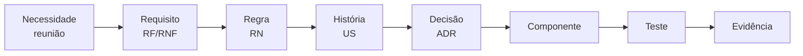
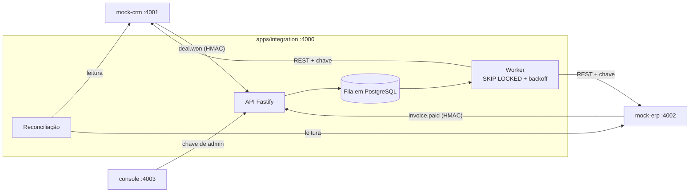
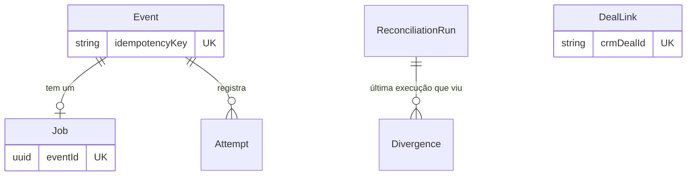
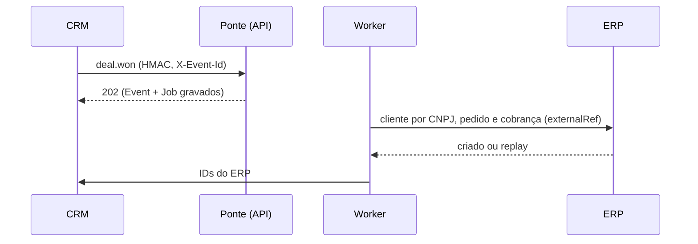

# Ponte

Integração CRM→ERP: quando um negócio é ganho, cria ou atualiza o cliente, o pedido e a cobrança, sem duplicar, com retentativa, fila de falhas e reconciliação.

[Problema](#o-problema-e-a-solução) · [Funcionalidades](#principais-funcionalidades) · [Ciclo de vida](#ciclo-de-vida-do-discovery-à-evolução) · [Arquitetura](#arquitetura-e-decisões-técnicas) · [Testes](#estratégia-de-testes-e-evidências) · [Competência → evidência](#competência--evidência) · [Documentos](#índice-dos-documentos-complementares)

## O problema e a solução

Cenário fictício: a Serviços Aurora, empresa de 25 pessoas, usa um CRM (sistema do comercial) e um ERP (sistema do financeiro) separados. A cada venda ganha, o financeiro digita de novo cliente, valor e prazo no ERP.
O ERP fica fora do ar das 23h à 1h por causa do backup e não reenvia o aviso que perdeu. Uma venda fechada nesse horário não pode se perder nem gerar cobrança em dobro.

A Ponte recebe o aviso de venda ganha, grava, cria cliente, pedido e cobrança no ERP, devolve os identificadores ao CRM e tenta de novo se o ERP estiver fora. **Prova:** com o ERP derrubado no meio de um lote de 20 negócios, 20 de 20 foram processados e houve 0 duplicidade ([resultado gravado](docs/05-qualidade/resultados/falha-injetada-cenario-a.json)). Termos técnicos: [glossário](docs/GLOSSARIO.md).

## Demonstração visual

<table>
<tr>
<td width="50%"> 01 · O negócio ganho no CRM e os IDs do ERP de volta</td>
<td width="50%"> 08 · Evento em retentativa com o ERP fora</td>
</tr>
<tr>
<td width="50%"> 11 · O mesmo evento concluído depois do reprocessamento</td>
<td width="50%"> 12 · Divergências apontadas pela reconciliação</td>
</tr>
</table>

As 17 telas, em ordem de história, estão na [galeria](docs/screenshots/README.md).

## Ficha técnica

| Campo | Informação |
|---|---|
| Natureza | Estudo de caso fictício |
| Stack | TypeScript, Node.js, Fastify, PostgreSQL, Prisma, OpenAPI, Vitest, Playwright |
| Sistemas | CRM e ERP simples criados no repositório (não são produtos comerciais) |
| Versão | 1.1.0 ([CHANGELOG](docs/06-pos-lancamento/CHANGELOG.md)) |
| Testes | 193 Vitest e 10 Playwright, registro de 2026-10-23, commit `fcf035d`; 193 Vitest reexecutados em 2026-10-24, commit `e960fbd` |
| CI | Não há workflow de CI |

## Principais funcionalidades

- **Webhook assinado** com HMAC e timestamp; assinatura inválida e replay são recusados ([ADR-009](docs/03-arquitetura/adr/ADR-009-seguranca-do-webhook.md)).
- **Idempotência em três camadas:** chave do evento, vínculo único por negócio e `externalRef` único no ERP ([ADR-003](docs/03-arquitetura/adr/ADR-003-idempotencia.md)).
- **Retentativa com backoff exponencial e jitter** e **fila de falhas (dead-letter)** com reprocessamento manual ([ADR-004](docs/03-arquitetura/adr/ADR-004-retentativa-com-backoff.md), [ADR-005](docs/03-arquitetura/adr/ADR-005-fila-de-falhas.md)).
- **Reconciliação** a cada 15 minutos e sob demanda, que aponta divergências sem corrigir em silêncio ([ADR-006](docs/03-arquitetura/adr/ADR-006-reconciliacao.md)).
- **Mapeamento de campos** versionado, com transformações de lista fechada ([ADR-008](docs/03-arquitetura/adr/ADR-008-mapeamento-configuravel.md)).
- **Contratos OpenAPI** (CRM, ERP e Ponte) e **catálogo de 35 erros** ([Episódio 4](docs/04-contratos-de-api/README.md)).
- **Painel de integração e alertas** de fila parada e de fila de falhas ([ADR-012](docs/03-arquitetura/adr/ADR-012-alerta-de-fila-parada.md)).

## Ciclo de vida: do discovery à evolução

O relatório completo está em [docs/ciclo-de-vida](docs/ciclo-de-vida/README.md); cada fase aponta para os documentos de origem.

| Fase | Página | O que mostra |
|---|---|---|
| Descoberta | [01 Visão e discovery](docs/ciclo-de-vida/01-visao-e-discovery.md) | Problema, partes interessadas, restrições, matriz de decisão |
| Planejamento | [02 Planejamento e Scrum](docs/ciclo-de-vida/02-planejamento-e-scrum.md) | Backlog, release plan, DoR e DoD, RACI, mudanças |
| Requisitos | [03 Requisitos e rastreabilidade](docs/ciclo-de-vida/03-requisitos-e-rastreabilidade.md) | 14 RF, 9 RNF, 12 RN, 13 histórias, matriz de 14 linhas |
| Arquitetura | [04 Arquitetura e ADRs](docs/ciclo-de-vida/04-arquitetura-e-adrs.md) | C4, componentes, estados, 12 ADRs |
| Dados | [05 Modelo de dados](docs/ciclo-de-vida/05-modelo-de-dados.md) | ER, dicionário, restrições, índices, migrations |
| Desenvolvimento | [06 Desenvolvimento e configuração](docs/ciclo-de-vida/06-desenvolvimento-e-configuracao.md) | Git, versões, contratos, CI, dívida técnica |
| Qualidade | [07 Testes e qualidade](docs/ciclo-de-vida/07-testes-e-qualidade.md) | Pirâmide, casos, execuções, defeitos |
| Operação | [08 Implantação e operação](docs/ciclo-de-vida/08-implantacao-e-operacao.md) | O que existe e o que é plano |
| Evolução | [09 Evolução e roadmap](docs/ciclo-de-vida/09-evolucao-e-roadmap.md) | Versões, mudanças, lacunas, roadmap |

## Linha do tempo e marcos

Datas do Git (observadas); o cronograma por semanas está em [docs/ciclo-de-vida](docs/ciclo-de-vida/README.md#linha-do-tempo) e é do cenário acadêmico.

| Marco | Referência | Data (Git) |
|---|---|---|
| Discovery, definição, arquitetura e contratos documentados | `809d63f` a `c8838b2` | 2026-10-23 |
| Núcleo da Ponte, CRM e ERP simples | `fa03086`, `afa6518`, `0bd9bbe` | 2026-10-23 |
| Versão 1.0.0 | tag `v1.0.0` | 2026-10-23 |
| Versão 1.1.0 (alerta de fila parada) | tag `v1.1.0` | 2026-10-23 |
| Apresentação, glossário e relatório do ciclo de vida | PRs #1 e #2, depois este relatório | 2026-10-24 |

## Scrum e planejamento de sprints

| Sprint | Objetivo | Registro |
|---|---|---|
| 1 | Fluxo feliz e fundação | [sprint 1](docs/ciclo-de-vida/sprints/sprint-1.md) |
| 2 | Confiabilidade: duplicidade, ERP fora, fora de ordem | [sprint 2](docs/ciclo-de-vida/sprints/sprint-2.md) |
| 3 | Visibilidade e consistência: painel, reconciliação | [sprint 3](docs/ciclo-de-vida/sprints/sprint-3.md) |
| 4 | Incremento v1.1: alerta de fila parada | [sprint 4](docs/ciclo-de-vida/sprints/sprint-4-incremento-v1-1.md) |

Product Goal, backlog priorizado, Definition of Ready e of Done em [Planejamento e Scrum](docs/ciclo-de-vida/02-planejamento-e-scrum.md).

## Reuniões e decisões com o cliente

| Reunião (simulada) | Decisão |
|---|---|
| [Reunião 1, gerente comercial](docs/01-discovery/03-reuniao-1-gerente-comercial.md) | "Na hora" vira "até 5 minutos" (RNF-01) |
| [Reunião 2, analista financeira](docs/01-discovery/04-reuniao-2-analista-financeira.md) | Valor a partir de R$ 50.000,00 nasce em conferência (RN-06) |
| [Reunião 3, responsável de TI](docs/01-discovery/05-reuniao-3-responsavel-de-ti.md) | ERP fora das 23h à 1h e sem reenvio: fila, retentativa e reconciliação obrigatória |
| [Aceitação](docs/05-qualidade/reuniao-de-aceitacao.md) e [retrospectiva](docs/06-pos-lancamento/retrospectiva.md) | Alerta de fila parada vira a v1.1; demais pedidos vão ao roadmap |

Índice das reuniões: [docs/ciclo-de-vida/reunioes](docs/ciclo-de-vida/reunioes/README.md).

## Requisitos e rastreabilidade

Cada necessidade chega a um teste na [matriz de 14 linhas](docs/02-definicao/07-rastreabilidade.md); a leitura guiada está em [03 Requisitos e rastreabilidade](docs/ciclo-de-vida/03-requisitos-e-rastreabilidade.md).

## Arquitetura e decisões técnicas

| Decisão | Por quê | Custo aceito |
|---|---|---|
| [ADR-003](docs/03-arquitetura/adr/ADR-003-idempotencia.md) Idempotência em três camadas | Cada camada cobre uma falha diferente | Mais restrições no banco e um campo de referência única no ERP |
| [ADR-004](docs/03-arquitetura/adr/ADR-004-retentativa-com-backoff.md) Backoff com jitter | `min(teto, base × 2^(n−1)) × (1 ± 20%)`; 12 tentativas cobrem a janela de 2 h | Em falha longa, reavaliação a cada 30 min |
| [ADR-006](docs/03-arquitetura/adr/ADR-006-reconciliacao.md) Reconciliação | O ERP não reenvia webhook perdido | Chamadas extras às duas APIs |

**Decisão difícil: webhook, consulta periódica ou os dois** ([ADR-001](docs/03-arquitetura/adr/ADR-001-eventos-vs-consulta-periodica.md)). Contexto: o comercial quer "na hora" e o ERP não reenvia webhook perdido. Alternativas: só webhook, só polling, ou híbrido. Escolha: híbrido, com eventos como caminho principal e reconciliação como rede de segurança. Custo aceito: dois mecanismos para manter. Mudaria se o CRM não tivesse webhook (polling incremental) ou se o ERP garantisse reenvio com confirmação.

Contêineres C4, componentes, estados e os 12 ADRs: [04 Arquitetura e ADRs](docs/ciclo-de-vida/04-arquitetura-e-adrs.md).

## Modelo de dados e banco

Idempotência por `Event.idempotencyKey` único, `DealLink.crmDealId` único e `externalRef` único no ERP; `Event` e `Job` entram na mesma transação. ER completo, dicionário, índices e migrations em [05 Modelo de dados](docs/ciclo-de-vida/05-modelo-de-dados.md).

## Fluxo principal

As seis sequências completas (feliz, duplicado, ERP fora, retorno ao CRM, pagamento, reconciliação) estão em [diagramas de sequência](docs/03-arquitetura/03-diagramas-de-sequencia.md).

## Estratégia de testes e evidências

| Camada | Testes | O que prova |
|---|---|---|
| Unitário | 106 | Transformações, mapeamento, backoff, HMAC, regras |
| Contrato | 18 | 44 de 44 operações dos três OpenAPI |
| Integração | 67 | Serviços reais com banco: idempotência, retentativa, reconciliação, segurança |
| Falha injetada | 2 | ERP derrubado no meio de um lote |
| E2E (Playwright) | 10 | Telas reais; gera os prints |

Contagens do registro de [2026-10-23, commit `fcf035d`](docs/05-qualidade/resultados/execucao-dos-testes.txt); o Vitest foi reexecutado em [2026-10-24, commit `e960fbd`](docs/ciclo-de-vida/evidencias/vitest-2026-10-24.txt) (193 passando).

- **Falha injetada:** cenário A, 20 de 20 processados e 0 duplicidade; cenário B, 5 na fila de falhas e 5 processados após reprocessar ([relato](docs/05-qualidade/falha-injetada.md)).
- **Defeitos:** 12 documentados, inclusive erros de teste e de desenho ([registro](docs/05-qualidade/bugs-e-aprendizados.md)).
- **Casos e limites:** [07 Testes e qualidade](docs/ciclo-de-vida/07-testes-e-qualidade.md).

## Implantação, operação e adoção

Existe a execução local, o painel, os alertas e o [guia de operação](docs/06-pos-lancamento/guia-de-operacao.md). Topologia de produção, rollout em modo sombra, rollback e treinamento são plano, não execução; detalhes em [08 Implantação e operação](docs/ciclo-de-vida/08-implantacao-e-operacao.md).

## Gestão de configuração e evolução

| Versão | Mudança | Compatibilidade |
|---|---|---|
| 1.0.0 | Primeira versão completa | OpenAPI do CRM e do ERP `1.0.0`, da Ponte `1.0.0` |
| 1.1.0 | Alerta de fila parada | Aditiva; OpenAPI da Ponte `1.1.0`; sem migração de banco |

Política de versão no [ADR-007](docs/03-arquitetura/adr/ADR-007-versionamento-da-api.md); commits em Conventional Commits; integração por PR. Detalhes em [06 Desenvolvimento e configuração](docs/ciclo-de-vida/06-desenvolvimento-e-configuracao.md).

## Competência → evidência

| Competência | Onde está a evidência |
|---|---|
| Desenhar integração entre sistemas | [ADR-007](docs/03-arquitetura/adr/ADR-007-versionamento-da-api.md), [ADR-008](docs/03-arquitetura/adr/ADR-008-mapeamento-configuravel.md), [ADR-009](docs/03-arquitetura/adr/ADR-009-seguranca-do-webhook.md), [mapa de dados](docs/01-discovery/07-mapa-de-dados.md) |
| Evitar duplicidade | [ADR-003](docs/03-arquitetura/adr/ADR-003-idempotencia.md), [falha injetada](docs/05-qualidade/falha-injetada.md) (cenário A: 0 duplicidade) |
| Tratar falha e recuperar | [ADR-004](docs/03-arquitetura/adr/ADR-004-retentativa-com-backoff.md), [ADR-005](docs/03-arquitetura/adr/ADR-005-fila-de-falhas.md), prints [08](docs/screenshots/08-painel-evento-em-retentativa.png), [10](docs/screenshots/10-painel-fila-de-falhas.png), [11](docs/screenshots/11-painel-reprocessamento.png) |
| Detectar divergência entre sistemas | [ADR-006](docs/03-arquitetura/adr/ADR-006-reconciliacao.md), [print 12](docs/screenshots/12-painel-divergencias-da-reconciliacao.png) |
| Documentar contrato de API | [CRM](docs/04-contratos-de-api/crm.openapi.yaml), [ERP](docs/04-contratos-de-api/erp.openapi.yaml), [Ponte](docs/04-contratos-de-api/ponte.openapi.yaml), [35 erros](docs/04-contratos-de-api/catalogo-de-erros.md), teste de contrato 44/44 |
| Modelar dados | [Modelo de dados](docs/ciclo-de-vida/05-modelo-de-dados.md), migração [0002](apps/integration/prisma/migrations/0002_customerlink_taxid_not_unique/migration.sql) |
| Operar e alertar | [ADR-012](docs/03-arquitetura/adr/ADR-012-alerta-de-fila-parada.md), prints [16](docs/screenshots/16-painel-alerta-de-fila-parada.png) e [17](docs/screenshots/17-painel-alerta-critico.png), [guia de operação](docs/06-pos-lancamento/guia-de-operacao.md) |
| Gerir requisitos e planejamento | [Rastreabilidade](docs/02-definicao/07-rastreabilidade.md), [Scrum](docs/ciclo-de-vida/02-planejamento-e-scrum.md), [sprints](docs/ciclo-de-vida/sprints/README.md) |
| Registrar os próprios erros | [Problemas e aprendizados](docs/05-qualidade/bugs-e-aprendizados.md) (12 itens) |
| Transformar restrição de TI em arquitetura | [Reunião 3 (simulada)](docs/01-discovery/05-reuniao-3-responsavel-de-ti.md), [ADR-001](docs/03-arquitetura/adr/ADR-001-eventos-vs-consulta-periodica.md) |

## Limitações, riscos e evolução prevista

- CRM e ERP são sistemas simples criados neste repositório.
- Reuniões, aceitação, retrospectiva e planejamento de sprints são do cenário acadêmico; os requisitos podem não refletir uma operação real.
- Sem teste de carga, sem a janela real de 2 horas (validada por cálculo) e sem usuários reais.
- Sem workflow de CI, sem rotina de backup e sem política de retenção de dados ([lacunas](docs/ciclo-de-vida/09-evolucao-e-roadmap.md#lacunas-identificadas-nesta-revisão-do-ciclo-de-vida)).
- Evolução prevista: evento de liberação de conferência, dois segredos de webhook, notificação ativa dos alertas ([roadmap](docs/06-pos-lancamento/roadmap.md)).

## Índice dos documentos complementares

[Guia da série e trilhas de leitura](docs/INDEX.md) · [Ciclo de vida](docs/ciclo-de-vida/README.md) · [Reuniões](docs/ciclo-de-vida/reunioes/README.md) · [Sprints](docs/ciclo-de-vida/sprints/README.md) · [Catálogo de diagramas](docs/ciclo-de-vida/diagramas/README.md) · [Galeria](docs/screenshots/README.md) · [Glossário](docs/GLOSSARIO.md) · [CHANGELOG](docs/06-pos-lancamento/CHANGELOG.md)

## Nota de contexto acadêmico

Este projeto é um estudo de caso acadêmico, com dados, empresas e atividades de gestão simulados.

A IA generativa (Claude, da Anthropic) foi utilizada como apoio ao desenvolvimento e à documentação. As decisões e os resultados foram revisados pelo autor, e os testes citados seguem as evidências registradas.

## Licença

[MIT](LICENSE).
