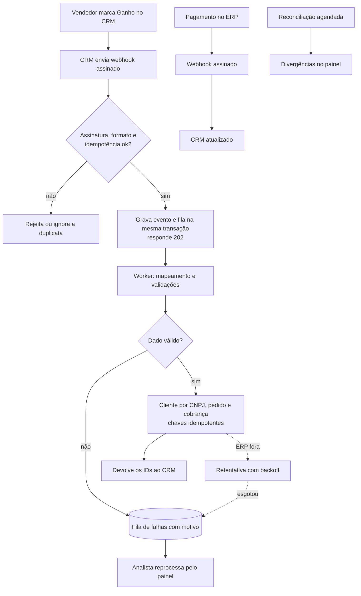

# Ponte

Integração CRM→ERP: quando um negócio é ganho, cria ou atualiza o cliente, o pedido e a cobrança, sem duplicar, com retentativa, fila de falhas e reconciliação.

## Em 30 segundos

- **Problema:** na Serviços Aurora (empresa fictícia), o financeiro redigita cada venda fechada do CRM no ERP, e o ERP fica fora do ar das 23h à 1h.
- **Solução:** a Ponte recebe o aviso de venda ganha, grava, cria cliente, pedido e cobrança no ERP e tenta de novo se ele estiver fora.
- **Prova:** 20 de 20 negócios processados e 0 duplicidade, com o ERP derrubado no meio do lote ([resultado gravado](docs/05-qualidade/resultados/falha-injetada-cenario-a.json)).
- **Comece por aqui:** [painel após o reprocessamento](docs/screenshots/11-painel-reprocessamento.png) · [teste de falha injetada](docs/05-qualidade/falha-injetada.md) · [ADR-003, idempotência em três camadas](docs/03-arquitetura/adr/ADR-003-idempotencia.md)

CRM é o sistema do comercial; ERP é o do financeiro (pedidos e cobranças). Os demais termos estão no [glossário](docs/GLOSSARIO.md).

## Ficha técnica

| Campo | Informação |
|---|---|
| Natureza | Caso fictício; empresa, pessoas e dados inventados |
| Sistemas | CRM e ERP simples criados neste repositório (não são produtos comerciais) |
| Discovery | 3 reuniões simuladas, marcadas nas atas ([episódio 1](docs/01-discovery/README.md)) |
| Stack | TypeScript, Node.js, Fastify, PostgreSQL, Prisma, Vitest, Playwright |
| Segurança do webhook | HMAC com timestamp ([ADR-009](docs/03-arquitetura/adr/ADR-009-seguranca-do-webhook.md)) |
| Testes | 193 Vitest e 10 Playwright passando; registro de 23/10/2026, commit `fcf035d` |
| Execução | Local; não hospedado |

<table>
<tr>
<td width="50%"><br><sub>01 · O negócio ganho no CRM e os IDs do ERP de volta</sub></td>
<td width="50%"><br><sub>08 · Evento em retentativa com o ERP fora</sub></td>
</tr>
<tr>
<td width="50%"><br><sub>11 · O mesmo evento concluído depois do reprocessamento</sub></td>
<td width="50%"><br><sub>12 · Divergências apontadas pela reconciliação</sub></td>
</tr>
</table>

As 16 telas, em ordem de história, estão na [galeria](docs/screenshots/README.md).

## Duas entradas

**Pelo lado do negócio.** Como a necessidade foi levantada, o que virou requisito, quais ganhos são hipótese e como alguém opera a integração no dia a dia: [Ep. 1 Discovery](docs/01-discovery/README.md), [Ep. 2 Definição (ganhos como hipótese)](docs/02-definicao/README.md), [Ep. 6 Pós-lançamento (guia de operação)](docs/06-pos-lancamento/README.md).

**Pelo lado técnico.** As decisões e seus custos, os contratos de API e a prova por teste, inclusive com o ERP derrubado de verdade: [Ep. 3 Arquitetura](docs/03-arquitetura/README.md), [Ep. 4 Contratos de API](docs/04-contratos-de-api/README.md), [Ep. 5 Qualidade](docs/05-qualidade/README.md).

## O problema

A Serviços Aurora, empresa fictícia de 25 pessoas, usa um CRM para as vendas e um ERP para pedidos e cobranças. Quando uma venda é ganha, o financeiro digita de novo cliente, valor e prazo no ERP.
O ERP fica fora do ar das 23h à 1h por causa do backup e não reenvia o aviso que perdeu. Uma venda fechada nesse horário não pode se perder nem gerar cobrança em dobro.

## Como funciona



- O CRM avisa a Ponte por webhook (um aviso enviado pela rede) quando o negócio é ganho; a assinatura HMAC prova a origem.
- A Ponte grava o evento e responde 202 sem esperar o ERP; um worker (processo de segundo plano) faz o trabalho depois.
- O cliente é identificado pelo CNPJ, e pedido e cobrança levam chaves idempotentes: repetir o evento não cria nada novo.
- Falha temporária é tentada de novo com espera crescente; dado inválido ou tentativas esgotadas vão para a fila de falhas (dead-letter), onde uma pessoa reprocessa pelo painel.
- O pagamento no ERP atualiza o CRM, e a reconciliação, a cada 15 minutos por padrão, compara os dois lados e aponta divergências.

Mais detalhe em [visão geral](docs/03-arquitetura/01-visao-geral.md), [modelo de dados](docs/03-arquitetura/02-modelo-de-dados.md), [diagramas de sequência](docs/03-arquitetura/03-diagramas-de-sequencia.md) e [modos de falha](docs/03-arquitetura/04-modos-de-falha.md).

## O que este projeto mostra

- **Idempotência em três camadas:** chave do evento na entrada, vínculo único por negócio e referência única no ERP ([ADR-003](docs/03-arquitetura/adr/ADR-003-idempotencia.md)).
- **Retentativa com backoff e jitter:** 12 tentativas somam cerca de 3 h 01 min, acima da janela de 2 h do ERP ([ADR-004](docs/03-arquitetura/adr/ADR-004-retentativa-com-backoff.md)).
- **Reconciliação obrigatória:** como o ERP não reenvia webhook, a comparação periódica é o que pega o evento perdido ([ADR-006](docs/03-arquitetura/adr/ADR-006-reconciliacao.md)).

## Competência → prova

| O que o projeto exercita | Onde está a prova |
|---|---|
| Desenhar integração entre sistemas (webhook assinado, mapeamento, versão) | [ADR-007](docs/03-arquitetura/adr/ADR-007-versionamento-da-api.md), [ADR-008](docs/03-arquitetura/adr/ADR-008-mapeamento-configuravel.md), [ADR-009](docs/03-arquitetura/adr/ADR-009-seguranca-do-webhook.md) e [mapa de dados](docs/01-discovery/07-mapa-de-dados.md) |
| Evitar duplicidade | [ADR-003](docs/03-arquitetura/adr/ADR-003-idempotencia.md) e [falha injetada](docs/05-qualidade/falha-injetada.md) (cenário A: 0 duplicidade) |
| Tratar falha e recuperar | [ADR-004](docs/03-arquitetura/adr/ADR-004-retentativa-com-backoff.md), [ADR-005](docs/03-arquitetura/adr/ADR-005-fila-de-falhas.md) e prints [08](docs/screenshots/08-painel-evento-em-retentativa.png), [10](docs/screenshots/10-painel-fila-de-falhas.png) e [11](docs/screenshots/11-painel-reprocessamento.png) |
| Detectar divergência entre sistemas | [ADR-006](docs/03-arquitetura/adr/ADR-006-reconciliacao.md) e [print 12](docs/screenshots/12-painel-divergencias-da-reconciliacao.png) |
| Documentar contrato de API | [CRM](docs/04-contratos-de-api/crm.openapi.yaml), [ERP](docs/04-contratos-de-api/erp.openapi.yaml) e [Ponte](docs/04-contratos-de-api/ponte.openapi.yaml) (OpenAPI), [catálogo de 35 erros](docs/04-contratos-de-api/catalogo-de-erros.md) e teste de contrato (44/44 operações) |
| Operar e alertar | [ADR-012](docs/03-arquitetura/adr/ADR-012-alerta-de-fila-parada.md), [print 16](docs/screenshots/16-painel-alerta-de-fila-parada.png) e [guia de operação](docs/06-pos-lancamento/guia-de-operacao.md) |
| Registrar os próprios erros | [Problemas e aprendizados](docs/05-qualidade/bugs-e-aprendizados.md) (12 itens) |
| Transformar restrição de TI em arquitetura | [Reunião simulada com TI](docs/01-discovery/05-reuniao-3-responsavel-de-ti.md) e [ADR-001](docs/03-arquitetura/adr/ADR-001-eventos-vs-consulta-periodica.md) |

## Episódios

| Episódio | O que tem |
|---|---|
| [0 — Sobre este caso](docs/00-sobre-este-caso/README.md) | O que é real e o que é cenário |
| [1 — Discovery](docs/01-discovery/README.md) | Alternativas, a empresa fictícia, 3 reuniões simuladas, AS-IS/TO-BE, mapa de dados |
| [2 — Definição](docs/02-definicao/README.md) | 14 RF, 9 RNF, 12 regras de negócio, 13 histórias, backlog, 10 riscos, rastreabilidade |
| [3 — Arquitetura](docs/03-arquitetura/README.md) | Visão geral, modelo de dados, 6 diagramas de sequência, 12 ADRs |
| [4 — Contratos de API](docs/04-contratos-de-api/README.md) | 3 OpenAPI, catálogo de 35 erros, exemplos, política de versão |
| [5 — Qualidade](docs/05-qualidade/README.md) | Estratégia, falha injetada, 12 defeitos, aceitação, registro dos testes |
| [6 — Pós-lançamento](docs/06-pos-lancamento/README.md) | Changelog, guia de operação, PR da v1.1, retrospectiva, roadmap |

Guia da série e trilhas de leitura de 2, 10 e 30 minutos: [docs/INDEX.md](docs/INDEX.md).

## Decisões que contam

| Decisão | Por que | Custo aceito |
|---|---|---|
| [ADR-003 — Idempotência em três camadas](docs/03-arquitetura/adr/ADR-003-idempotencia.md) | Cada camada cobre uma falha diferente: reenvio e concorrência na entrada, vínculo único por negócio, `externalRef` único no ERP | Mais restrições no banco e um campo de referência única no ERP |
| [ADR-004 — Retentativa com backoff e jitter](docs/03-arquitetura/adr/ADR-004-retentativa-com-backoff.md) | `min(teto, base × 2^(n−1)) × (1 ± 20%)`; 12 tentativas cobrem a janela de 2 h do ERP | Em falha longa, o evento só é reavaliado a cada 30 min |
| [ADR-006 — Reconciliação](docs/03-arquitetura/adr/ADR-006-reconciliacao.md) | O ERP não reenvia webhook perdido; compara CRM e ERP e registra divergências | Chamadas extras às duas APIs; comparação em memória |

### A decisão difícil: webhook, consulta periódica ou os dois

Fonte: [ADR-001](docs/03-arquitetura/adr/ADR-001-eventos-vs-consulta-periodica.md).

| | |
|---|---|
| **Contexto** | O comercial quer "na hora"; o ERP não reenvia webhook perdido ([reunião 1](docs/01-discovery/03-reuniao-1-gerente-comercial.md) e [reunião 3](docs/01-discovery/05-reuniao-3-responsavel-de-ti.md), simuladas) |
| **Alternativas** | 1. Só webhook. 2. Só consulta periódica. 3. Híbrida: eventos como caminho principal e reconciliação periódica como rede de segurança |
| **Escolha** | A opção 3 |
| **Custo aceito** | Dois mecanismos para manter e explicar; o custo do polling é baixo porque a reconciliação roda a cada 15 minutos (padrão) |
| **Quando mudaria** | Se o CRM não oferecesse webhook, polling incremental como caminho principal; se o ERP garantisse reenvio com confirmação, menos reconciliação |

## Evidências

- **Testes:** 193 Vitest e 10 Playwright passando, registro de 23/10/2026, commit `fcf035d` ([saída](docs/05-qualidade/resultados/execucao-dos-testes.txt)).
- **Falha injetada:** 20 de 20 negócios processados e 0 duplicidade, com o ERP derrubado no meio do lote ([relato](docs/05-qualidade/falha-injetada.md)).
- **Contrato:** 44 de 44 operações dos três OpenAPI exercitadas ([estratégia e resultados](docs/05-qualidade/README.md#resultado-da-execução-registrada)).
- **Defeitos:** 12 documentados, inclusive erros de teste e de desenho ([registro](docs/05-qualidade/bugs-e-aprendizados.md)).

## Rodar localmente

Precisa de Node.js (testado com a versão 24) e Docker. Nada é publicado em servidor.

```bash
npm install            # instala as dependências e gera os clientes Prisma
npm run setup          # gera o .env local com segredos aleatórios (não versionado)
npm run db:up          # PostgreSQL 16 em contêiner, porta 5452
npm run db:migrate     # cria as tabelas dos três bancos
npm run dev:demo       # sobe CRM, ERP, Ponte e painel
```

| Serviço | Endereço |
|---|---|
| CRM simples | http://localhost:4001/ui |
| ERP simples | http://localhost:4002/ui |
| Painel de integração | http://localhost:4003 |
| API da Ponte | http://localhost:4000 (`/health`, `/v1/webhooks/*`, `/v1/admin/*`) |

Cenários de demonstração, testes e prints (com o aviso de que `test:e2e` e `test:record` regravam os registros): [guia de operação](docs/06-pos-lancamento/guia-de-operacao.md#cenários-de-demonstração).

## O que falta para sair do estudo

- **CRM e ERP reais:** os dois são sistemas simples criados no repositório ([Ep. 0](docs/00-sobre-este-caso/README.md)).
- **Carga, janela real de 2 horas e usuários reais:** não testados; a janela foi validada por cálculo ([limites declarados](docs/05-qualidade/README.md#o-que-eu-não-testei-limites-declarados)).
- **Entrada validada só por simulação:** os requisitos podem não refletir uma operação real ([limitações](docs/06-pos-lancamento/roadmap.md#limitações-conhecidas)).
- **Hospedagem:** a execução é só local ([ADR-011](docs/03-arquitetura/adr/ADR-011-execucao-local.md) e [roadmap](docs/06-pos-lancamento/roadmap.md)).

## Limites

- CRM e ERP simples, criados neste repositório.
- Aceite e retrospectiva simulados.
- Sem teste de carga, sem a janela real de 2 horas e sem usuários reais.
- Sem hospedagem.

Licença [MIT](LICENSE).
