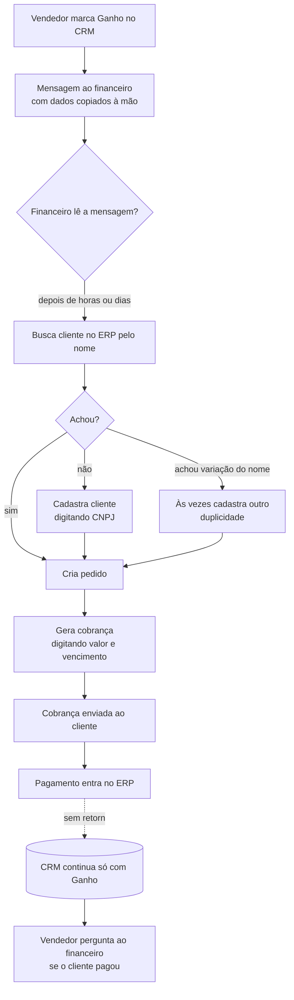
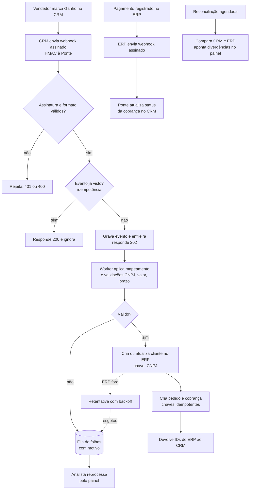

# 06 — AS-IS e TO-BE

## AS-IS: como a venda chega à cobrança hoje

Pontos de perda: P1 a P7 em [02-negocio-aurora.md](02-negocio-aurora.md).

## TO-BE: com a Ponte

## O que muda para cada pessoa

| Pessoa | Antes | Depois |
|---|---|---|
| Vendedor | Manda mensagem e pergunta se foi pago | Vê IDs do ERP e o status da cobrança no CRM |
| Financeiro | Redigita e confere de memória | Recebe cobrança pronta; confere só as de valor alto; vê falhas e divergências no painel |
| TI | Sem visibilidade | Painel com eventos, tempo de processamento, tentativas e catálogo de erros |
