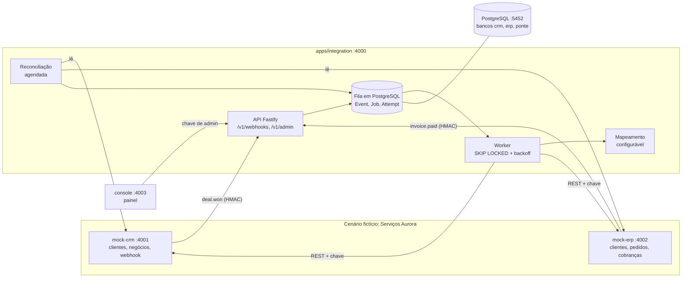

# 01 — Visão geral da arquitetura

A Ponte fica entre o CRM e o ERP. Ela **nunca** é chamada de forma síncrona para "fazer o trabalho": ela recebe, grava e responde; um worker faz o trabalho depois.

## Responsabilidades

| Componente | Faz | Não faz |
|---|---|---|
| `mock-crm` | Guarda clientes e negócios; emite `deal.won` assinado ao marcar Ganho; recebe IDs e status de cobrança da Ponte | Não conhece o ERP |
| `mock-erp` | Guarda clientes, pedidos e cobranças; emite `invoice.paid` assinado; é idempotente por `externalRef`; pode ser derrubado nos testes | Não conhece o CRM |
| Ponte (`integration`) | Valida, grava, enfileira, mapeia, cria no ERP, devolve ao CRM, retenta, isola falhas, reconcilia | Não decide regra comercial além das RN |
| `console` | Mostra e aciona (reprocessar, reconciliar) através da API administrativa | Não guarda estado |

## Princípios que guiaram o desenho
1. **Gravar antes de processar** (RNF-02): o `202` só sai depois do evento estar no banco.
2. **Cada passo é idempotente**: qualquer passo pode ser repetido sem efeito colateral.
3. **Falhas são dados**: tentativa, erro e causa ficam registrados, não só em log.
4. **O que não dá para garantir por evento, garante-se por comparação**: reconciliação (RNF-09).
5. **Contratos primeiro**: OpenAPI antes do código, e teste de contrato depois.

## Tecnologias e onde as decisões estão

| Escolha | Decisão |
|---|---|
| Fastify (Node, TypeScript) | [ADR-010](adr/ADR-010-fastify-vs-next.md) |
| PostgreSQL + Prisma | [ADR-002](adr/ADR-002-fila-em-banco-vs-broker.md), [ADR-011](adr/ADR-011-execucao-local.md) |
| Zod para validar entrada | validação de payload na borda e das saídas do mapeamento |
| Vitest, Playwright | [Qualidade](../05-qualidade/) |
