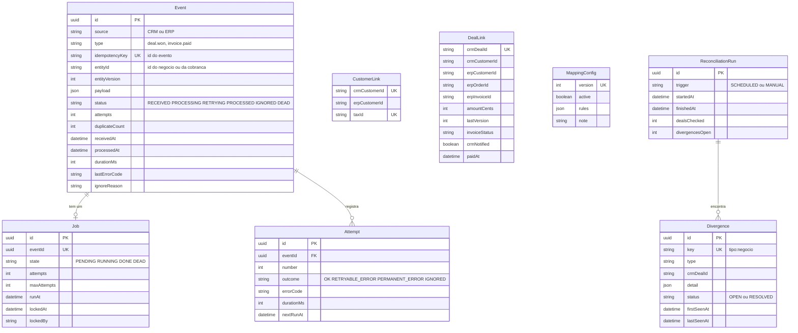
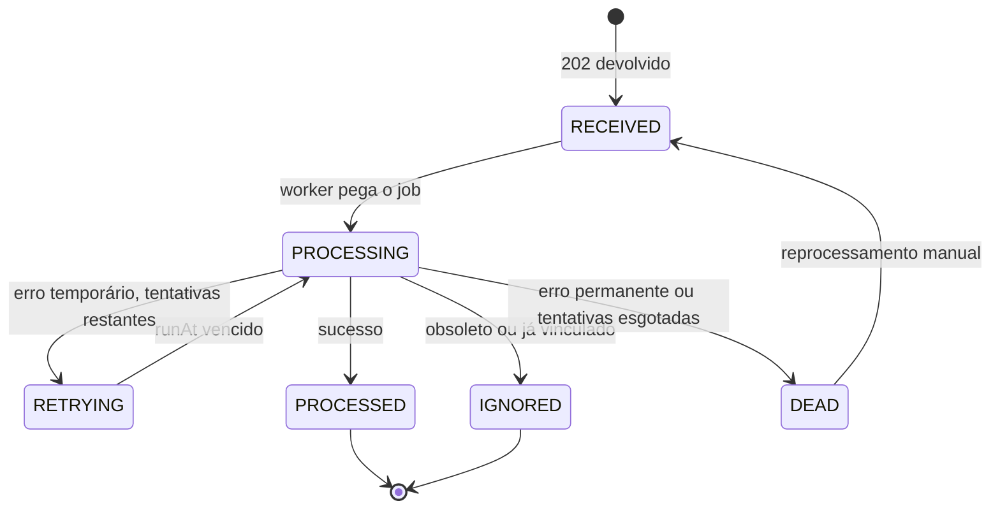

# 02 — Modelo de dados da Ponte

Banco `ponte` (PostgreSQL), modelado em Prisma (`apps/integration/prisma/schema.prisma`). O CRM e o ERP têm bancos próprios (`crm`, `erp`) e não compartilham tabelas com a Ponte.

## Restrições que sustentam as garantias

| Garantia | Restrição no banco |
|---|---|
| Evento não é processado duas vezes (RF-03) | `Event.idempotencyKey` único; inserção concorrente cai em violação de unicidade, tratada como duplicata |
| Um negócio, um pedido (RN-03) | `DealLink.crmDealId` único |
| Um cliente por CNPJ (RN-02) | `CustomerLink.taxId` único (e `taxId` único no ERP) |
| Um job por evento | `Job.eventId` único; o reprocessamento reinicia o mesmo job |
| Uma divergência aberta por tipo e negócio | `Divergence.key` único; a reconciliação faz upsert |
| Fila durável e atômica com o evento | `Event` e `Job` são inseridos na **mesma transação** |

## Máquina de estados do evento

