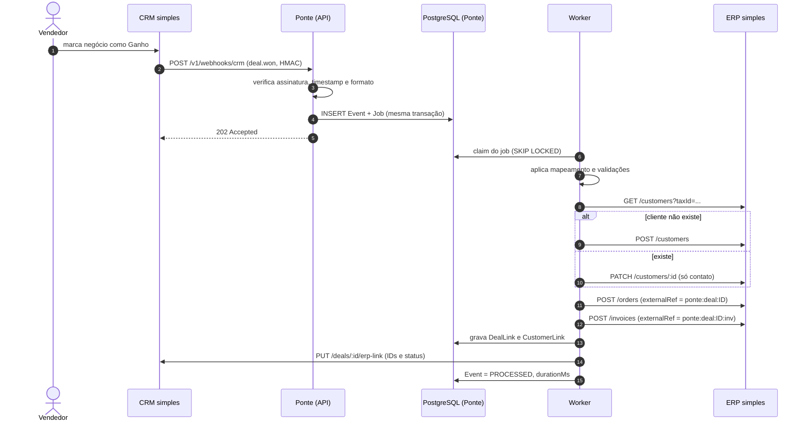
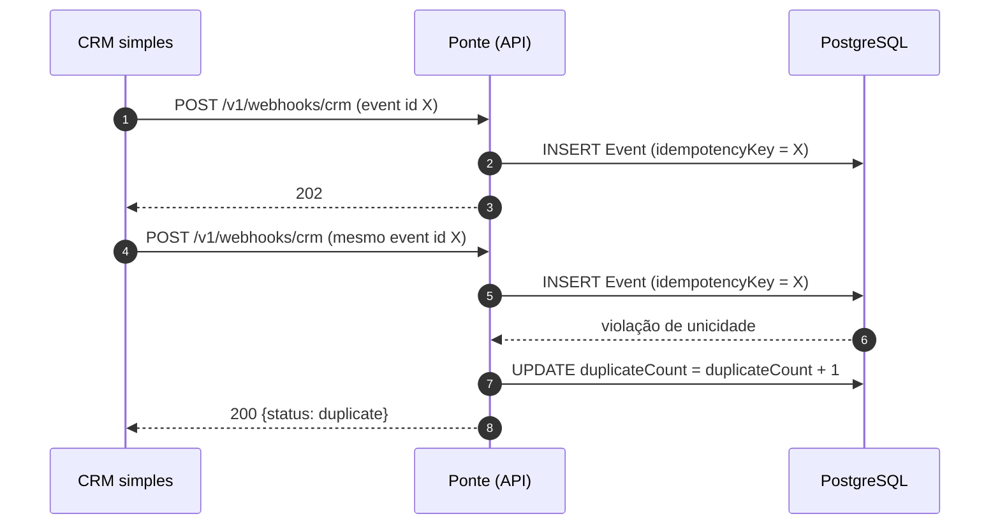
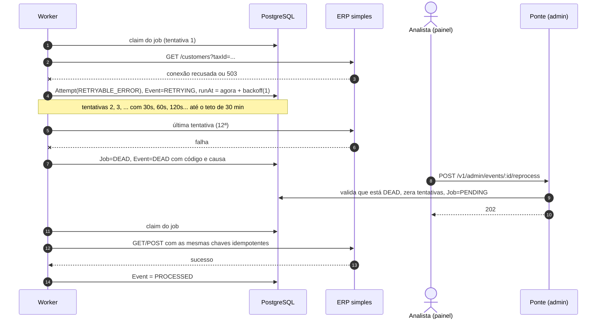
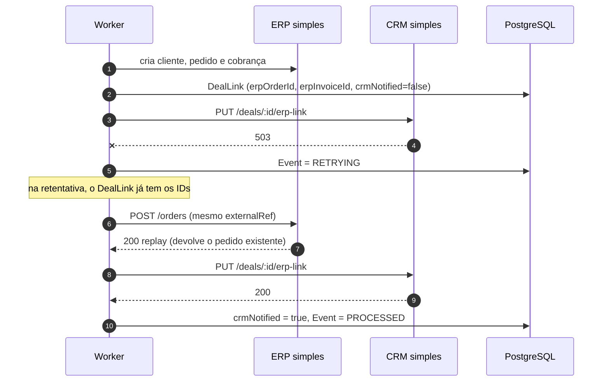
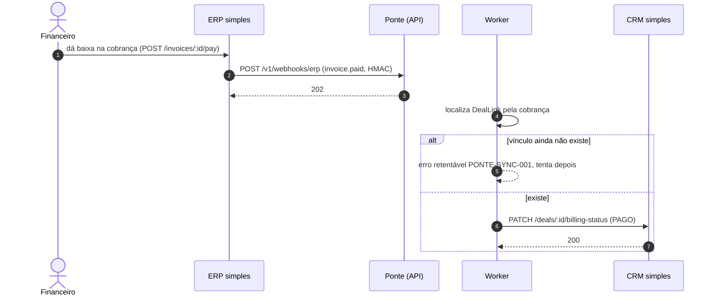
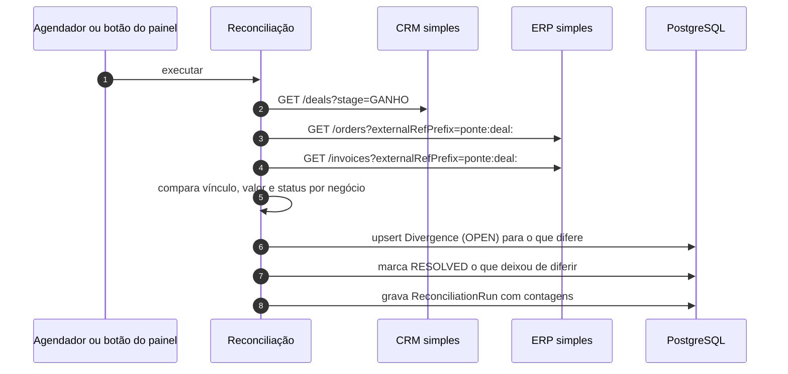

# 03 — Diagramas de sequência

## 1. Fluxo feliz: negócio ganho → cliente, pedido e cobrança → IDs no CRM

## 2. Evento duplicado

## 3. ERP fora: retentativas, fila de falhas (dead-letter) e reprocessamento manual

## 4. Falha no retorno ao CRM (pedido já criado)

## 5. Pagamento no ERP → CRM atualizado

## 6. Reconciliação

