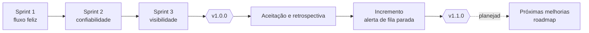

# 02 — Planejamento e Scrum

Fase C: como o escopo foi ordenado, entregue e revisado. O backlog, as histórias e as revisões de sprint têm origem nos documentos citados; os artefatos de cerimônia (planejamento, Definition of Ready e Done, RACI, cronograma) foram elaborados para o cenário acadêmico.

[← Índice do ciclo de vida](README.md) · Anterior: [01 Visão e discovery](01-visao-e-discovery.md) · Próxima: [03 Requisitos e rastreabilidade](03-requisitos-e-rastreabilidade.md)

## Product Goal

Uma venda ganha no CRM vira cliente, pedido e cobrança no ERP, sem duplicar, mesmo com o ERP fora do ar, e quem opera a integração enxerga o que falhou e por quê.

## Product Backlog priorizado

Origem: [histórias e MoSCoW](../02-definicao/02-historias-e-moscow.md) e [backlog em 3 sprints](../02-definicao/04-backlog-em-3-sprints.md). A justificativa vem do valor para o fluxo principal e do risco que cada item reduz.

| Ordem | História | MoSCoW | Sprint | Por que nesta posição |
|---|---|---|---|---|
| 1 | US-01 Receber o negócio ganho com segurança | Must | 1 | Sem entrada segura não há fluxo; reduz R-05 |
| 2 | US-02 Cliente sem duplicidade | Must | 1 | Reduz R-01 |
| 3 | US-03 Pedido e cobrança no ERP | Must | 1 | Entrega o valor central |
| 4 | US-04 IDs do ERP no CRM | Must | 1 | Fecha o ciclo para o vendedor |
| 5 | US-05 Evento repetido é ignorado | Must | 2 | Reduz R-01 e R-02 |
| 6 | US-06 Retentativa quando o ERP falha | Must | 2 | Restrição da reunião 3 |
| 7 | US-07 Fila de falhas (dead-letter) e reprocessamento | Must | 2 | Requisito da reunião 2: a venda não pode sumir |
| 8 | US-13 Evento fora de ordem | Should | 2 | Reduz R-08 |
| 9 | US-09 Reconciliação aponta divergências | Must (promovida na reunião 3) | 3 | Único mecanismo contra webhook perdido |
| 10 | US-11 Painel de integração | Must (básico) | 3 | Sem ele as falhas não são visíveis |
| 11 | US-08 Pagamento atualiza o CRM | Should | 3 | Valor para o vendedor, sem risco de integridade |
| 12 | US-12 Catálogo de erros | Should | 3 | Causa e ação para o financeiro |
| 13 | US-10 Mapeamento de campos configurável | Should | 1 e 3 | Flexibilidade; o MVP já usa regras em dados |

Itens fora do MVP (Won't): nota fiscal, sistemas reais, multiempresa, mensageria externa, cancelamento ou alteração de pedido e evento de liberação de conferência.

## Release plan

| Release | Escopo | Critério de liberação | Situação |
|---|---|---|---|
| v1.0.0 | Sprints 1 a 3: fluxo, confiabilidade, painel, reconciliação, contratos | Todas as histórias Must aceitas; testes verdes; contratos validados | Entregue (tag `v1.0.0`) |
| v1.1.0 | Alerta de fila parada ([ADR-012](../03-arquitetura/adr/ADR-012-alerta-de-fila-parada.md)) | Mudança aditiva; teste de contrato com cobertura total | Entregue (tag `v1.1.0`) |
| Próxima | Itens 1 a 3 do [roadmap](../06-pos-lancamento/roadmap.md) | A definir | Planejada, sem data |

## Sprints

Cada sprint tem uma página com objetivo, escopo, critérios de conclusão, revisão e retrospectiva: [índice das sprints](sprints/README.md).

| Sprint | Objetivo | Janela planejada (cronograma acadêmico) | Evidência |
|---|---|---|---|
| [1](sprints/sprint-1.md) | Negócio ganho vira cliente, pedido e cobrança, e os IDs voltam ao CRM | 2026-09-21 a 2026-10-02 | [revisão](../05-qualidade/sprint-1-review.md) |
| [2](sprints/sprint-2.md) | A integração sobrevive a duplicidade, ERP fora e evento fora de ordem | 2026-10-05 a 2026-10-16 | [revisão](../05-qualidade/sprint-2-review.md) |
| [3](sprints/sprint-3.md) | O financeiro enxerga e controla; os dois lados convergem | 2026-10-19 a 2026-10-23 | [revisão](../05-qualidade/sprint-3-review.md) |
| [4 (incremento)](sprints/sprint-4-incremento-v1-1.md) | Alerta de fila parada | 2026-10-23 | [PR da v1.1](../06-pos-lancamento/pr-v1.1.md) |

As sprints do projeto são marcos de entrega, sem duração registrada ([backlog](../02-definicao/04-backlog-em-3-sprints.md)). As janelas acima organizam o cenário; não são datas de commit.

## Definition of Ready

Uma história entra na sprint quando:
1. tem critérios de aceite no formato Dado/Quando/Então;
2. aponta os requisitos (RF/RNF) e as regras (RN) que cobre;
3. tem o risco que reduz identificado, quando houver;
4. não depende de decisão arquitetural aberta (a decisão tem ADR ou entra na própria sprint).

## Definition of Done

Uma história está concluída quando:
1. o comportamento tem teste automatizado (unitário, integração, contrato ou E2E) que passa;
2. o contrato OpenAPI está atualizado e validado por teste de contrato, quando a API muda;
3. decisões novas têm ADR com alternativas, motivo, trade-off e "quando mudar";
4. a rastreabilidade ([matriz](../02-definicao/07-rastreabilidade.md)) aponta para o componente e o teste;
5. nenhum segredo entra no repositório.

## Cerimônias

| Cerimônia | Registro |
|---|---|
| Kickoff e discovery | [reunião de kickoff e roteiro](reunioes/00-kickoff-e-roteiro-de-discovery.md), [3 reuniões](reunioes/README.md) |
| Sprint Planning e refinamento | seção "Planejamento" de cada [sprint](sprints/README.md) |
| Sprint Review | [revisões de sprint](../05-qualidade/sprint-1-review.md) e seção "Revisão" de cada página |
| Retrospectiva | seção "Retrospectiva" de cada sprint e [retrospectiva da v1.0](../06-pos-lancamento/retrospectiva.md) |
| Aceitação | [reunião de aceitação](../05-qualidade/reuniao-de-aceitacao.md) |

## Gestão de riscos, impedimentos e dependências

Os 10 riscos estão em [riscos](../02-definicao/05-riscos.md). Impedimentos encontrados e como foram tratados estão no [registro de problemas](../05-qualidade/bugs-e-aprendizados.md): porta 5440 ocupada (item 1), testes disputando o mesmo banco (itens 7 e 8) e asserção de tempo medindo relógios diferentes (item 12).

| Dependência | Efeito se falhar | Tratamento |
|---|---|---|
| PostgreSQL local | Sem fila, sem eventos | [ADR-011](../03-arquitetura/adr/ADR-011-execucao-local.md) |
| ERP simples com referência externa única | Sem a 3ª camada de idempotência | [ADR-003](../03-arquitetura/adr/ADR-003-idempotencia.md) |
| Segredos de webhook por variável de ambiente | O serviço não sobe | [ADR-009](../03-arquitetura/adr/ADR-009-seguranca-do-webhook.md) |

## Gestão de mudanças

| Pedido | Origem | Decisão | Destino |
|---|---|---|---|
| Reconciliação deixa de ser "bom ter" | Reunião 3 | Aceito | Must no MVP |
| "Na hora" vira "até 5 minutos" | Reunião 1 | Aceito (refinamento) | RNF-01 |
| Alerta de fila parada | Aceitação e retrospectiva | Aceito | v1.1.0 |
| Aviso ao vendedor quando o evento vai para a fila de falhas | Aceitação | Adiado: a Ponte não tem canal de notificação | Roadmap, item 4 |
| Evento de liberação de conferência | Aceitação e retrospectiva | Adiado | Roadmap, item 1 |
| Aceitar dois segredos de webhook | Aceitação e retrospectiva | Adiado | Roadmap, item 2 |
| Nota fiscal, multiempresa, cancelamento de pedido | Escopo inicial | Recusado para o MVP | Fora do escopo |

## Critérios para repriorizar o backlog

1. Um risco de duplicidade ou de perda de evento sobe qualquer item.
2. Uma restrição nova de uma reunião muda a prioridade (foi o caso da reconciliação).
3. Pedido de aceitação só entra se couber em mudança aditiva de contrato.
4. A ordem de corte é fixa: v1.1, guias, E2E, sincronização de volta, painel avançado, retrospectiva; a reconciliação é cortada por último ([backlog](../02-definicao/04-backlog-em-3-sprints.md)).

## Indicadores de fluxo e entrega

Não há dados observados de velocity, lead time nem burndown: o estudo foi executado em sequência e o tempo por sprint não foi medido. O que existe como indicador observável por sprint é a entrega: histórias aceitas, testes que as cobrem e defeitos registrados (ver cada [página de sprint](sprints/README.md)).

## Matriz RACI

R = executa, A = responde pela decisão, C = consultado, I = informado. Os papéis são os do cenário fictício.

| Atividade | Consultor/dev | Gerente comercial | Analista financeira | Responsável de TI |
|---|---|---|---|---|
| Levantar necessidades | R, A | C | C | C |
| Definir requisitos e regras | R, A | C | C | C |
| Decidir arquitetura (ADRs) | R, A | I | I | C |
| Construir e testar | R, A | I | I | I |
| Aceitar entregas | R | A | C | C |
| Operar a integração | C | I | R | R, A |
| Priorizar o roadmap | R | C | C | C, A |
