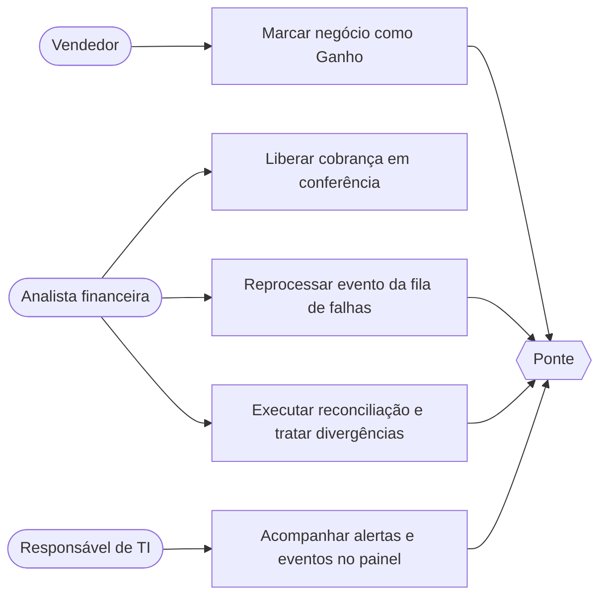
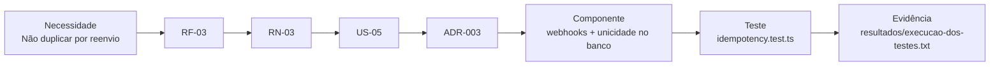

# 03 — Requisitos e rastreabilidade

Fase B: como as necessidades das três reuniões viraram requisitos, regras, histórias, decisões, código e testes. Os requisitos completos estão em [Episódio 2](../02-definicao/README.md); esta página mostra o encadeamento.

[← Índice do ciclo de vida](README.md) · Anterior: [02 Planejamento e Scrum](02-planejamento-e-scrum.md) · Próxima: [04 Arquitetura e ADRs](04-arquitetura-e-adrs.md)

## Do que foi dito ao que foi especificado

| Necessidade (reunião) | Requisito | Regra |
|---|---|---|
| "Não pode duplicar" (comercial e financeiro) | RF-03, RF-04 | RN-02, RN-03 |
| Chegar ao ERP em até 5 minutos (comercial) | RNF-01 | — |
| Conferir antes de cobrar valores altos (financeiro) | RF-05 | RN-06 |
| Saber o motivo de cada falha (financeiro) | RF-09, RF-13 | RN-09, RN-10 |
| ERP fora das 23h à 1h (TI) | RF-02, RF-08, RNF-03 | RN-09 |
| ERP não reenvia webhook perdido (TI) | RF-12, RNF-09 | RN-11 |
| Ninguém de fora dispara um "ganho" falso (TI) | RF-01, RNF-04 | RN-01 |

## Inventário

| Conjunto | Quantidade | Faixa de IDs | Documento |
|---|---|---|---|
| Requisitos funcionais | 14 | RF-01 a RF-14 | [requisitos](../02-definicao/01-requisitos.md) |
| Requisitos não funcionais | 9 | RNF-01 a RNF-09 | [requisitos](../02-definicao/01-requisitos.md) |
| Regras de negócio | 12 | RN-01 a RN-12 | [regras](../02-definicao/03-regras-de-negocio.md) |
| Histórias de usuário | 13 | US-01 a US-13 | [histórias e MoSCoW](../02-definicao/02-historias-e-moscow.md) |
| Riscos | 10 | R-01 a R-10 | [riscos](../02-definicao/05-riscos.md) |

## Priorização MoSCoW

| Classe | Histórias | Justificativa |
|---|---|---|
| Must | US-01 a US-07, US-09, US-11 (básico) | Sem elas o fluxo não é seguro ou não é visível; a US-09 foi promovida de Could na reunião 3 |
| Should | US-08, US-10, US-12, US-13 | Valor claro, sem comprometer a integridade do fluxo principal |
| Won't (MVP) | Nota fiscal, sistemas reais, multiempresa, mensageria externa, cancelamento de pedido, evento de liberação de conferência | Fora do escopo ou adiado |

## Casos de uso principais

O fluxo de negócio antes e depois da Ponte está nos diagramas de [AS-IS e TO-BE](../01-discovery/06-as-is-to-be.md).

## Rastreabilidade

A matriz completa tem 14 linhas, de necessidade a teste: [rastreabilidade](../02-definicao/07-rastreabilidade.md). Um exemplo do encadeamento:

## Critérios de aceite

Cada história tem critérios Dado/Quando/Então em [histórias e MoSCoW](../02-definicao/02-historias-e-moscow.md). A aceitação do produto ([reunião de aceitação](../05-qualidade/reuniao-de-aceitacao.md), simulada) marcou US-01 a US-13 como aceitas; a US-09 com a ressalva de que a liberação de conferência no ERP não gera evento (RN-12).

| Fluxo crítico | Critério | Prova automatizada |
|---|---|---|
| Entrada segura | Assinatura inválida: 401 e nada gravado | `webhook-security.test.ts` |
| Sem duplicidade | Mesmo evento duas vezes e 10 disparos simultâneos: um só pedido | `idempotency.test.ts` |
| ERP fora | Evento não se perde; termina processado ou na fila de falhas | `erp-down-batch.test.ts` |
| Divergência | Cinco tipos detectados; só o status da cobrança tem correção assistida | `reconciliation.test.ts` |
| Contrato | Respostas reais batem com os três OpenAPI; 44 de 44 operações | `tests/contract` |

## Mudanças de requisitos

O registro de pedidos aceitos, adiados e recusados está em [Planejamento e Scrum](02-planejamento-e-scrum.md#gestão-de-mudanças).
