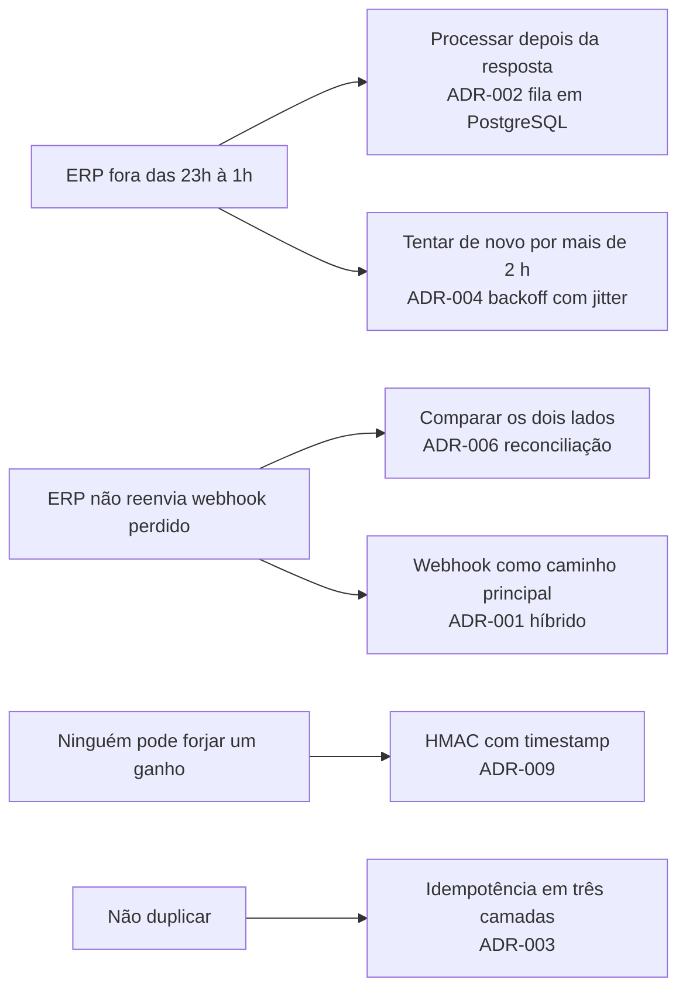
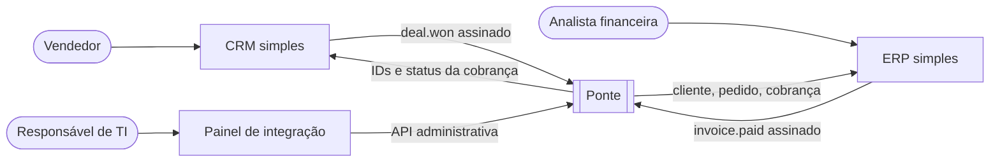
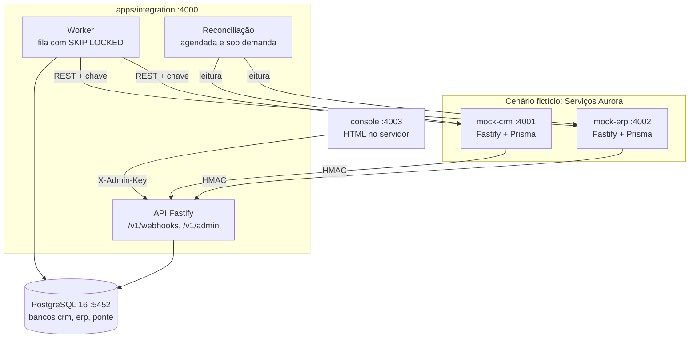
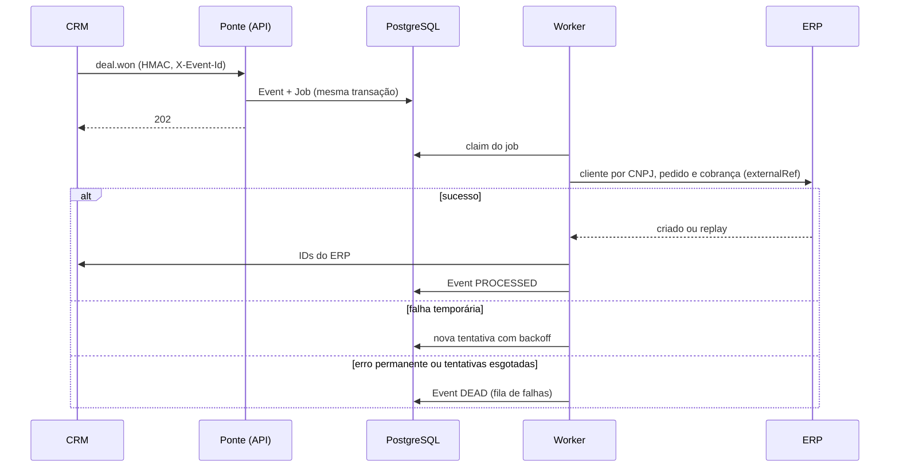
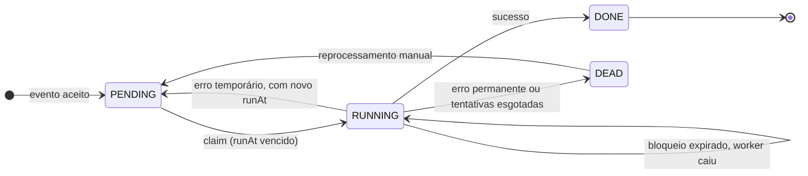
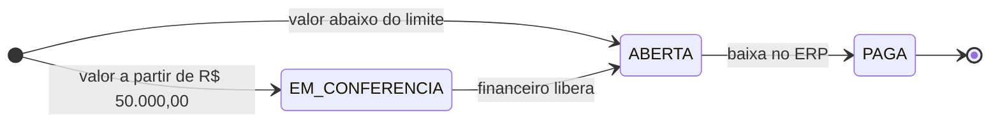
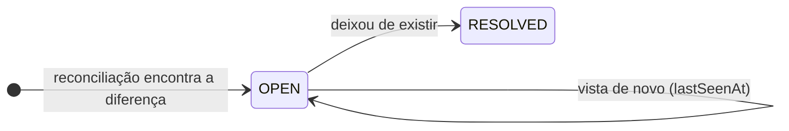

# 04 — Arquitetura e ADRs

Fase D: o desenho que responde à restrição do ERP e as decisões que o sustentam. Os diagramas desta página representam o código atual; os documentos de origem estão no [Episódio 3](../03-arquitetura/README.md).

[← Índice do ciclo de vida](README.md) · Anterior: [03 Requisitos e rastreabilidade](03-requisitos-e-rastreabilidade.md) · Próxima: [05 Modelo de dados](05-modelo-de-dados.md)

## Da restrição ao desenho

## Contexto (C4, nível 1)

## Contêineres (C4, nível 2)

Portas padrão de desenvolvimento. CRM, ERP e Ponte têm um banco cada, no mesmo servidor PostgreSQL.

## Componentes da Ponte

| Componente | Código | Responsabilidade |
|---|---|---|
| Entrada de webhooks | `apps/integration/src/webhooks/routes.ts` | Valida HMAC, timestamp e contrato; grava `Event` e `Job` na mesma transação; responde 202 |
| Fila e worker | `apps/integration/src/queue/` (`queue.ts`, `worker.ts`, `backoff.ts`) | Claim com `SKIP LOCKED`, retentativa, estado `DEAD` |
| Mapeamento | `apps/integration/src/mapping/` | Regras em dados e transformações de lista fechada |
| Tratadores | `apps/integration/src/handlers/` (`deal-won.ts`, `invoice-paid.ts`) | Regras de negócio RN-01 a RN-08 |
| Clientes HTTP | `apps/integration/src/clients/` | Chamadas ao CRM e ao ERP com chave e timeout |
| Reconciliação | `apps/integration/src/reconciliation/reconciler.ts` | Compara os dois lados e registra divergências |
| API administrativa | `apps/integration/src/routes/admin.ts` | Eventos, reprocessamento, métricas, mapeamento, alertas |
| Alertas | `apps/integration/src/alerts.ts` | Fila parada e fila de falhas (v1.1) |
| Compartilhado | `packages/shared/src/` | HMAC, CNPJ, catálogo de erros, esquemas de evento |

## Fluxo principal

Resumo do caminho feliz e das falhas. Os seis diagramas de sequência completos (feliz, duplicado, ERP fora, falha no retorno ao CRM, pagamento e reconciliação) estão em [diagramas de sequência](../03-arquitetura/03-diagramas-de-sequencia.md).

## Estados

Estado do evento (`Event.status`): ver o diagrama em [modelo de dados](../03-arquitetura/02-modelo-de-dados.md#máquina-de-estados-do-evento). Estados do job, da cobrança no ERP e da divergência, todos presentes no código:

## Decisões (ADRs)

Todas têm contexto, alternativas, escolha, motivo, trade-off e "quando mudar". Índice completo em [Episódio 3](../03-arquitetura/README.md).

| ADR | Decisão | Alternativa principal descartada | Consequência aceita |
|---|---|---|---|
| [001](../03-arquitetura/adr/ADR-001-eventos-vs-consulta-periodica.md) | Webhook como caminho principal e reconciliação como rede de segurança | Só webhook; só polling | Dois mecanismos para manter |
| [002](../03-arquitetura/adr/ADR-002-fila-em-banco-vs-broker.md) | Fila própria em PostgreSQL | Broker externo; pg-boss | Código da fila é mantido aqui |
| [003](../03-arquitetura/adr/ADR-003-idempotencia.md) | Idempotência em três camadas | Só deduplicar o evento; só no destino | Mais restrições e um campo de referência no ERP |
| [004](../03-arquitetura/adr/ADR-004-retentativa-com-backoff.md) | Backoff exponencial com jitter, 12 tentativas | Intervalo fixo; sem retentativa | Em falha longa, reavaliação a cada 30 min |
| [005](../03-arquitetura/adr/ADR-005-fila-de-falhas.md) | Estado `DEAD` com reprocessamento manual | Descartar; reprocessar sozinho | Depende de alguém olhar a fila |
| [006](../03-arquitetura/adr/ADR-006-reconciliacao.md) | Comparação periódica somente-leitura | Nenhuma; ressincronização total | Chamadas extras às duas APIs |
| [007](../03-arquitetura/adr/ADR-007-versionamento-da-api.md) | Versão no caminho e SemVer no contrato | Sem versão; cabeçalho | URLs mudam entre versões maiores |
| [008](../03-arquitetura/adr/ADR-008-mapeamento-configuravel.md) | Regras em dados, lista fechada | Código fixo; expressões no banco | Transformação nova exige código |
| [009](../03-arquitetura/adr/ADR-009-seguranca-do-webhook.md) | HMAC-SHA256 com timestamp | Chave em cabeçalho; lista de IPs; mTLS | Rotação de segredo com indisponibilidade curta |
| [010](../03-arquitetura/adr/ADR-010-fastify-vs-next.md) | Fastify nos quatro serviços; painel em HTML no servidor | Next.js; Express | Telas mais artesanais, sem tempo real |
| [011](../03-arquitetura/adr/ADR-011-execucao-local.md) | Docker Compose só para o PostgreSQL | Tudo em contêiner | Quem roda precisa de Node e Docker |
| [012](../03-arquitetura/adr/ADR-012-alerta-de-fila-parada.md) | Alerta calculado sob demanda | Notificação ativa; tabela de alertas | Depende de consulta ao painel ou à API |

## Requisitos de qualidade

| Atributo | Como é atendido | Verificação |
|---|---|---|
| Segurança | HMAC com janela de 5 min, comparação em tempo constante, chave administrativa, segredos em variável de ambiente | `webhook-security.test.ts`, `hmac.test.ts` |
| Disponibilidade | Gravar antes de processar; retentativa de cerca de 3 h 01 min | `erp-down-batch.test.ts`, `backoff.test.ts` |
| Manutenibilidade | Poucas peças, contratos antes do código, ADRs | [Modelo de dados](05-modelo-de-dados.md), contratos |
| Observabilidade | Log estruturado com correlação, tentativas por evento, painel, alertas | [Guia de operação](../06-pos-lancamento/guia-de-operacao.md) |
| Desempenho | Sem teste de carga; tempos locais apenas indicativos | [Limites declarados](../05-qualidade/README.md#o-que-eu-não-testei-limites-declarados) |
