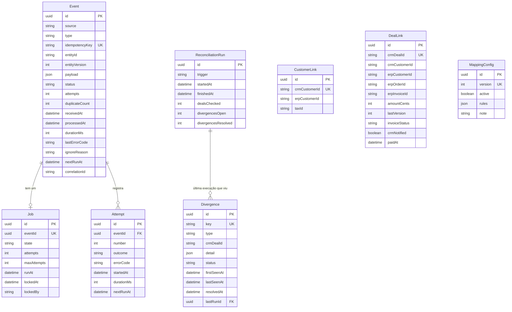
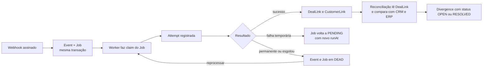

# 05 — Modelo de dados

Fase E: os dados que sustentam idempotência, tentativas, reprocessamento e reconciliação. O modelo vem de `apps/integration/prisma/schema.prisma`, e o ER abaixo lista as entidades e os campos que existem nele. Texto de apoio: [modelo de dados (Episódio 3)](../03-arquitetura/02-modelo-de-dados.md).

[← Índice do ciclo de vida](README.md) · Anterior: [04 Arquitetura e ADRs](04-arquitetura-e-adrs.md) · Próxima: [06 Desenvolvimento e configuração](06-desenvolvimento-e-configuracao.md)

## Bancos

| Banco | Dono | Conteúdo |
|---|---|---|
| `ponte` | Ponte | Eventos, fila, tentativas, vínculos, mapeamento, reconciliação |
| `crm` | CRM simples | Clientes, negócios, entregas de webhook |
| `erp` | ERP simples | Clientes, pedidos, cobranças, entregas de webhook |

Os três não compartilham tabelas. A Ponte só conhece o CRM e o ERP pelas APIs.

## ER da Ponte

`CustomerLink`, `DealLink` e `MappingConfig` não têm chave estrangeira para as demais tabelas: ligam identificadores do CRM e do ERP e são consultados por esses identificadores.

## Dicionário de dados

Valores permitidos de colunas de estado são os que o código grava.

| Tabela | Campo | Tipo | Regra | Uso |
|---|---|---|---|---|
| Event | idempotencyKey | texto, único | Id do evento do produtor | Barra duplicata e concorrência (RF-03) |
| Event | status | texto | `RECEIVED`, `PROCESSING`, `RETRYING`, `PROCESSED`, `IGNORED`, `DEAD` | Máquina de estados do evento |
| Event | entityId, entityVersion | texto, inteiro | Id e versão do negócio ou da cobrança | Evento fora de ordem (RN-07) |
| Event | payload | json | Corpo do evento como recebido | Reprocessamento com o mesmo conteúdo |
| Event | duplicateCount | inteiro | Duplicatas descartadas | Painel |
| Job | eventId | texto, único | Um job por evento | Fila |
| Job | state | texto | `PENDING`, `RUNNING`, `DONE`, `DEAD` | Fila de trabalhos |
| Job | runAt, lockedAt, lockedBy | data, data, texto | Vencimento e bloqueio | Claim com `SKIP LOCKED`; retomada de job preso |
| Attempt | outcome | texto | `OK`, `RETRYABLE_ERROR`, `PERMANENT_ERROR`, `IGNORED` | Histórico mostrado no painel |
| Attempt | errorCode | texto | Código do [catálogo de erros](../04-contratos-de-api/catalogo-de-erros.md) | Causa e ação recomendada |
| CustomerLink | taxId | texto | CNPJ em 14 dígitos; **não único** | Vários clientes do CRM com o mesmo CNPJ apontam para um cliente do ERP |
| DealLink | crmDealId | texto, único | Um negócio, um pedido (RN-03) | Idempotência por negócio |
| DealLink | amountCents | inteiro | Valor em centavos | Comparação na reconciliação |
| DealLink | crmNotified | booleano | IDs já devolvidos ao CRM | Retentativa só do retorno |
| MappingConfig | version, active | inteiro único, booleano | Uma versão ativa | Mapeamento versionado (ADR-008) |
| Divergence | key | texto, único | `tipo:negócio` | Upsert pela reconciliação |
| Divergence | type | texto | `NOT_SYNCED`, `AMOUNT_MISMATCH`, `BILLING_STATUS_MISMATCH`, `ORDER_MISSING_IN_ERP`, `CRM_LINK_MISSING` | Tipos de divergência |
| Divergence | status | texto | `OPEN`, `RESOLVED` | Ciclo da divergência |

## Integridade e índices

| Garantia | Mecanismo no banco | Teste que a exercita |
|---|---|---|
| Evento não é processado duas vezes | `Event.idempotencyKey` único; inserção concorrente cai em violação de unicidade, tratada como duplicata | `idempotency.test.ts` |
| Um negócio, um pedido | `DealLink.crmDealId` único | `idempotency.test.ts`, `happy-path.test.ts` |
| Um job por evento | `Job.eventId` único | `retry-deadletter.test.ts` |
| Uma divergência por tipo e negócio | `Divergence.key` único | `reconciliation.test.ts` |
| Fila durável e atômica com o evento | `Event` e `Job` na mesma transação | `erp-down-batch.test.ts` |
| Pedido e cobrança não duplicam no ERP | `externalRef` único em `Order` e `Invoice` do ERP; CNPJ único em `Customer` do ERP | `happy-path.test.ts`, [falha injetada](../05-qualidade/falha-injetada.md) |
| Consulta rápida | Índices: `Event(status)`, `Event(entityId)`, `Event(receivedAt)`, `Job(state, runAt)`, `Attempt(eventId)`, `CustomerLink(taxId)`, `DealLink(erpInvoiceId)`, `Divergence(status)` | Declarados no schema; sem medição de desempenho |

## Normalização e decisões de modelagem

- **Entidades separadas por responsabilidade:** o evento (o que chegou), o job (quando e quem processa), a tentativa (o que aconteceu) e os vínculos (o que existe no ERP) mudam em ritmos diferentes.
- **Campos derivados no `Event`:** `attempts`, `duplicateCount` e `durationMs` repetem informação que poderia ser calculada a partir de `Attempt`. Foi uma escolha para que o painel liste eventos sem agregações; o custo é manter os contadores consistentes no código.
- **Payload em JSON:** guarda o corpo recebido, o que permite reprocessar e investigar sem depender do CRM.
- **Unicidade do CNPJ no ERP, não no vínculo:** `CustomerLink.taxId` era único por engano e foi corrigido pela migração `0002` ([registro de problemas, item 2](../05-qualidade/bugs-e-aprendizados.md)).

## Migrations, seeds e dados de demonstração

| Item | Situação |
|---|---|
| `apps/integration/prisma/migrations/0001_init` | Criação das tabelas da Ponte |
| `apps/integration/prisma/migrations/0002_customerlink_taxid_not_unique` | Troca o índice único de `CustomerLink.taxId` por índice comum |
| Mapeamento inicial | Criado na inicialização da Ponte quando não existe versão (`ensureDefaultMapping`), com a versão 1 mostrada no [print 13](../screenshots/13-painel-mapeamento-de-campos.png); a corrida na criação foi corrigida (item 6 do registro de problemas) |
| Dados de demonstração | Gerados pelos scripts `demo` e pelo roteiro E2E; não há seed estático |

## Retenção, auditoria, privacidade e acesso

- **Auditoria:** tentativas e erros ficam em `Attempt`, e versões de mapeamento ficam em `MappingConfig`; não há trilha de quem acionou um reprocessamento.
- **Privacidade:** o `payload` guarda CNPJ, e-mail e telefone do cliente fictício. Não há política de retenção nem expurgo implementados; em uso real isso exigiria prazo de guarda e mascaramento.
- **Acesso:** as rotas administrativas exigem `X-Admin-Key`, vinda de variável de ambiente ([ADR-009](../03-arquitetura/adr/ADR-009-seguranca-do-webhook.md)).

## Fluxo dos dados

