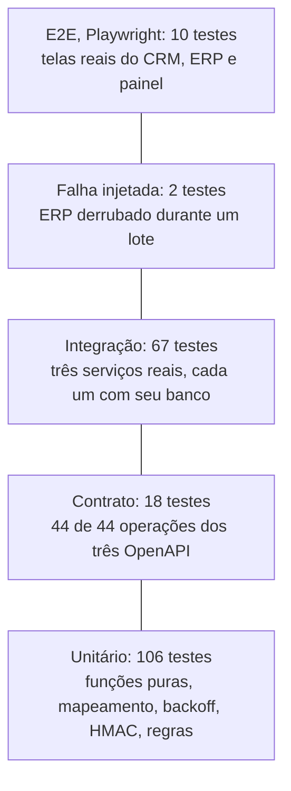

# 07 — Testes e qualidade

Fase G: o que foi provado, com que evidência, e o que ficou sem prova. A estratégia e os registros anteriores estão em [Episódio 5](../05-qualidade/README.md); esta página os conecta aos requisitos e acrescenta uma execução nova.

[← Índice do ciclo de vida](README.md) · Anterior: [06 Desenvolvimento e configuração](06-desenvolvimento-e-configuracao.md) · Próxima: [08 Implantação e operação](08-implantacao-e-operacao.md)

## Pirâmide de testes

Contagens por camada vêm do [registro desta sessão](evidencias/vitest-2026-10-24.txt) (Vitest) e do [registro de 2026-10-23](../05-qualidade/resultados/execucao-dos-testes.txt) (Playwright).

## Estratégia

| Camada | Onde | O que prova |
|---|---|---|
| Unitário | `apps/**/src/**/*.test.ts`, `packages/**/src/**/*.test.ts` | Transformações (CNPJ, telefone, valor, prazo), motor de mapeamento, backoff, HMAC, regras de negócio, catálogo de erros, alertas |
| Integração | `tests/integration` | Serviços reais conversando por HTTP: fluxo feliz, idempotência, retentativa, fila de falhas, fora de ordem, pagamento, reconciliação, mapeamento, segurança, fila, alertas |
| Contrato | `tests/contract` | Respostas reais validadas contra os OpenAPI; eventos validados contra o esquema do produtor e do consumidor; o teste falha se alguma operação ficar sem exercício |
| Falha injetada | `tests/failure` | ERP fechado de verdade no meio de um lote |
| E2E | `e2e/` | Telas reais dirigidas por navegador; também gera os prints |

Não há mocks de HTTP nos testes de integração: o servidor chamado é o de verdade ([estratégia completa](../05-qualidade/README.md#estratégia-de-testes)).

## Casos por tipo

| Tipo | Exemplos | Arquivo |
|---|---|---|
| Positivo | Negócio ganho gera cliente, pedido e cobrança e devolve os IDs ao CRM | `happy-path.test.ts` |
| Positivo | Pagamento no ERP atualiza o CRM | `payment-sync.test.ts` |
| Negativo | Assinatura inválida, timestamp fora da janela e corpo adulterado são recusados | `webhook-security.test.ts` (13) |
| Negativo | CNPJ, valor ou prazo inválidos vão à fila de falhas sem criar nada no ERP | `retry-deadletter.test.ts`, `transforms.test.ts` |
| Limite | Valor acima de R$ 1 milhão rejeitado; prazo de 0 a 90 dias; cobrança de R$ 50.000,00 em conferência | `transforms.test.ts` (48), `rules.test.ts` |
| Limite | Janela de retentativa: 12 tentativas somam cerca de 3 h 01 min | `backoff.test.ts` |
| Concorrência | 10 disparos simultâneos do mesmo evento; dois workers nunca pegam o mesmo job | `idempotency.test.ts`, `queue.test.ts` |
| Fora de ordem | Evento de versão menor é ignorado; pagamento antes do vínculo é retentado | `out-of-order.test.ts`, `payment-sync.test.ts` |
| Resiliência | ERP derrubado durante 20 negócios; ERP fora além das tentativas e reprocessamento | `erp-down-batch.test.ts` |

## Testes de requisitos e rastreabilidade

Cada requisito tem teste associado na [matriz de rastreabilidade](../02-definicao/07-rastreabilidade.md) e na tabela "O que os testes cobrem, por requisito" do [Episódio 5](../05-qualidade/README.md#o-que-os-testes-cobrem-por-requisito).

## Regressão

A suíte completa é a rede de regressão. A v1.1.0 acrescentou 16 testes (8 unitários e 8 de integração do alerta) e o teste de contrato passou a exercitar `/v1/admin/alerts`, sem alterar os testes anteriores: de 177 Vitest e 9 E2E na v1.0.0 para 193 Vitest e 10 E2E na v1.1.0 ([CHANGELOG](../06-pos-lancamento/CHANGELOG.md)).

## Execuções registradas

| Registro | Data | Commit | Resultado | Escopo |
|---|---|---|---|---|
| [execucao-dos-testes.txt](../05-qualidade/resultados/execucao-dos-testes.txt) | 2026-10-23 | `fcf035d` | 193 Vitest e 10 Playwright passando | Registro oficial da v1.1.0 |
| [vitest-2026-10-24.txt](evidencias/vitest-2026-10-24.txt) | 2026-10-24 | `e960fbd` | 23 arquivos, 193 testes, todos passando (Node v24.14.0) | Reexecução do Vitest para este relatório |

A reexecução rodou só `npx vitest run`. O E2E não foi reexecutado porque regrava os prints de `docs/screenshots`. O código de produção entre `fcf035d` e `e960fbd` mudou apenas em versões de pacote, no script de gravação, num gerador de documentação e em ajustes de dois arquivos de teste (`backoff.test.ts` e `retry-deadletter.test.ts`); a lista está em `git diff --stat fcf035d e960fbd -- apps packages tests scripts`.

O teste de falha injetada grava os JSON de resultado em `docs/05-qualidade/resultados/`. A reexecução de 2026-10-24 regravou o do cenário A; essa regravação foi descartada e os JSON de 2026-10-23 foram mantidos como evidência (os tempos variam entre rodadas, o resultado final não).

Como o teste de contrato exige cobertura total, a passagem dos 18 testes de contrato implica as 44 operações exercitadas (13 do CRM, 17 do ERP, 14 da Ponte).

## Falha injetada

Cenário A: 20 negócios, ERP derrubado no meio do lote, 20 de 20 processados, 16 com retentativa, maior número de tentativas 6, 0 duplicidade. Cenário B: ERP fora além das tentativas, 5 de 5 na fila de falhas e 5 de 5 processados após o reprocessamento manual. Fonte: [falha-injetada.md](../05-qualidade/falha-injetada.md) e os JSON em [resultados](../05-qualidade/resultados/falha-injetada-cenario-a.json). Os tempos variam entre rodadas; o resultado final não.

## Defeitos e análise de causa raiz

Doze itens registrados em [problemas e aprendizados](../05-qualidade/bugs-e-aprendizados.md). Resumo por causa:

| Causa | Itens | Exemplo |
|---|---|---|
| Erro de desenho | 2 | `CustomerLink.taxId` único por engano; migração `0002` |
| Erro de teste | 3, 7, 8, 11, 12 | Teste comparando relógios diferentes (item 12) |
| Defeito do produto achado por teste de contrato | 4, 5 | `POST /pay` sem corpo respondia 400; status 400 fixo onde o contrato dizia 422 |
| Corrida real no produto | 6 | Dois processos criando o mapeamento padrão ao mesmo tempo |
| Tratamento de erro no produto | 9, 10 | Erro de dado numa rota virava 500 (9); reconciliação com ERP fora respondia 500 (10) |
| Ambiente | 1 | Porta 5440 em uso |

## Segurança, desempenho e acessibilidade

| Tema | Situação |
|---|---|
| Segurança | HMAC, janela de 5 min e replay testados; sem teste de canal lateral de tempo e sem pentest (limite declarado) |
| Desempenho | Sem teste de carga; tempos de 122 a 465 ms do ganho até `PROCESSED` valem só para o ambiente local |
| Acessibilidade | Não testada; o painel é HTML renderizado no servidor, sem auditoria de acessibilidade |
| Navegadores | E2E só em Chromium |

## Limitações da estratégia

Lista completa em [limites declarados](../05-qualidade/README.md#o-que-eu-não-testei-limites-declarados): carga, janela real de 2 horas (validada por cálculo), vários processos completos da Ponte ao mesmo tempo e usuários reais.

## Casos propostos, ainda não implementados

| Caso | Requisito | Por que ainda não existe |
|---|---|---|
| Dois processos completos da Ponte disputando a mesma fila | R-10, ADR-002 | O `SKIP LOCKED` está provado no nível da fila, não em processo completo |
| Rotação de segredo com dois segredos aceitos | Roadmap, item 2 | A funcionalidade não existe |
| Teste de carga com volume de lote de fim de mês | RNF-01 | Sem dado de volume real |
