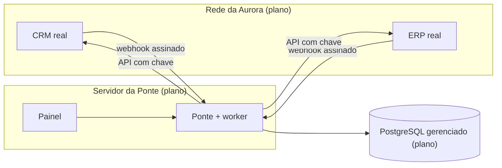

# 08 — Implantação, operação e adoção

Fase H: como o produto seria disponibilizado e incorporado à operação. **O que existe** é a execução local, o painel, os alertas e o guia de operação. **O que é plano** (topologia, rollout, rollback, treinamento, indicadores de adoção) é um artefato do estudo de caso: nada foi implantado em servidor nem usado por operação real.

[← Índice do ciclo de vida](README.md) · Anterior: [07 Testes e qualidade](07-testes-e-qualidade.md) · Próxima: [09 Evolução e roadmap](09-evolucao-e-roadmap.md)

## O que existe e o que é plano

| Item | Situação | Fonte |
|---|---|---|
| Execução local com Docker (PostgreSQL) e `npm` | Existe | [CONTRIBUTING.md](../../CONTRIBUTING.md), [ADR-011](../03-arquitetura/adr/ADR-011-execucao-local.md) |
| Painel, alertas, `/health`, métricas | Existe | [Guia de operação](../06-pos-lancamento/guia-de-operacao.md), [ADR-012](../03-arquitetura/adr/ADR-012-alerta-de-fila-parada.md) |
| Migrations do banco | Existe | `apps/*/prisma/migrations` |
| Topologia de produção, rollout e rollback | Plano | esta página |
| Treinamento e indicadores de adoção | Plano | esta página |
| CI/CD, deploy, monitoramento externo | Não existe | [06](06-desenvolvimento-e-configuracao.md#cicd-e-automações) |

## Arquitetura de implantação

### Existente (local)

Um PostgreSQL 16 em contêiner com três bancos e os quatro serviços Node em processos separados, nas portas 4000 a 4003 (detalhes em [04](04-arquitetura-e-adrs.md#contêineres-c4-nível-2)).

### Planejada para um ambiente real

Premissas do plano: um processo da Ponte (o `SKIP LOCKED` permite mais, mas dois processos completos não foram testados); segredos e chaves em variáveis de ambiente do servidor; o painel atrás de autenticação da rede interna, já que a chave administrativa fica no servidor do painel ([ADR-010](../03-arquitetura/adr/ADR-010-fastify-vs-next.md)).

## Ambientes e configuração

| Ambiente | Situação | Particularidades |
|---|---|---|
| Desenvolvimento local | Existe | `dev:demo` com retentativa curta para demonstração |
| Teste | Existe | Bancos `*_test` e `*_e2e` separados, portas livres ou 4100 a 4103 |
| Homologação e produção | Plano | Política padrão de retentativa (12 tentativas, 30 s a 30 min) |

Variáveis que mudam o comportamento (tentativas, janelas, limites de conferência e de alerta, intervalo da reconciliação) estão na tabela do [guia de operação](../06-pos-lancamento/guia-de-operacao.md#variáveis-que-mudam-o-comportamento).

## Dependências externas

CRM e ERP (APIs com chave e webhooks assinados), PostgreSQL e o relógio do banco, que agenda as retentativas e mede a idade da fila ([ADR-012](../03-arquitetura/adr/ADR-012-alerta-de-fila-parada.md)).

## Plano de implantação e rollout (plano)

1. **Modo sombra:** a Ponte recebe os webhooks e processa contra um ambiente de homologação do ERP, enquanto o financeiro continua digitando. Compara-se o resultado com o que o financeiro lança. É a validação que as [hipóteses de ganho](../02-definicao/06-ganhos-como-hipoteses.md) pedem antes de trocar números simulados por medidos.
2. **Base de 2 a 4 semanas** de vendas, tempo por repasse e erros achados na conferência, conforme o mesmo documento.
3. **Ativação por etapa:** primeiro o evento de ganho; depois a sincronização do pagamento; por fim a reconciliação agendada.
4. **Critério para avançar:** zero duplicidade na comparação, fila de falhas explicada pelos códigos do catálogo e nenhum alerta crítico sem causa conhecida.

## Plano de rollback (plano)

| Situação | Ação |
|---|---|
| Comportamento inesperado no fluxo | Desativar o webhook no CRM; o financeiro volta ao repasse manual; eventos já recebidos ficam no banco e podem ser reprocessados |
| Versão nova com defeito | Reverter o merge da versão; a v1.1.0 foi aditiva e **sem mudança de banco** ([PR da v1.1](../06-pos-lancamento/pr-v1.1.md)), então não há migração a desfazer |
| Mapeamento errado | Publicar de novo a versão anterior pela API; o histórico de versões é mantido ([ADR-008](../03-arquitetura/adr/ADR-008-mapeamento-configuravel.md)) |
| Evento com dado errado | Corrigir no CRM e remarcar o "Ganho", que gera um evento novo ([guia](../06-pos-lancamento/guia-de-operacao.md#evento-na-fila-de-falhas)) |

## Migração e preparação dos dados

As migrations criam as tabelas da Ponte. Não há carga inicial de clientes: o cliente do ERP é encontrado pelo CNPJ quando o primeiro negócio chega. Dados já existentes no CRM e no ERP antes da ativação não seriam sincronizados retroativamente; a reconciliação apontaria `NOT_SYNCED` para negócios ganhos sem vínculo, que exigiriam decisão humana (plano).

## Treinamento, documentação operacional e onboarding (plano)

| Público | Conteúdo | Material existente |
|---|---|---|
| Analista financeira | Ler a fila de falhas, reprocessar, tratar divergências | [Guia de operação](../06-pos-lancamento/guia-de-operacao.md), [catálogo de erros](../04-contratos-de-api/catalogo-de-erros.md) |
| Responsável de TI | Alertas, variáveis, troca de mapeamento e de segredo | [Guia de operação](../06-pos-lancamento/guia-de-operacao.md) |
| Vendedor | Ver IDs e status da cobrança no CRM | [Galeria, prints 01 e 05](../screenshots/README.md) |

## Monitoramento, logs, alertas e suporte

| Recurso | Descrição | Situação |
|---|---|---|
| Painel | Visão geral, eventos, fila de falhas, divergências, mapeamento, catálogo | Existe |
| Alertas | `QUEUE_STALLED` (limite de 300 s; crítico a partir de 3×) e `DEAD_LETTERS_PRESENT` | Existe; [prints 16 e 17](../screenshots/README.md) |
| Saúde | `GET /health` com estado do worker | Existe |
| Logs | Estruturados, com `eventId` e identificador de correlação | Existe |
| Notificação ativa dos alertas | E-mail ou chat | Não existe; [roadmap](../06-pos-lancamento/roadmap.md), item 3 |
| Fluxo de suporte | Situação → ação, no guia de operação | Existe como documento |

## Indicadores de adoção e critérios de sucesso

| Indicador | Origem | Observado? |
|---|---|---|
| Redigitação evitada (H1: 6,75 h/mês com as entradas simuladas) | [Ganhos como hipóteses](../02-definicao/06-ganhos-como-hipoteses.md) | Não: fórmula com entradas simuladas |
| Divergências por mês, taxa de erro de digitação (H2) | Idem | Não: a taxa atual é desconhecida |
| Latência do ganho à cobrança (H3), meta de 5 minutos | RNF-01 | Só em ambiente local: 122 a 465 ms |
| Eventos na fila de falhas e idade da fila | Painel | Disponível na operação, sem série histórica |

## Riscos operacionais e continuidade

| Risco | Tratamento | Referência |
|---|---|---|
| Fila parada sem ninguém ver | Alerta e guia de operação | R-07, [ADR-012](../03-arquitetura/adr/ADR-012-alerta-de-fila-parada.md) |
| ERP fora além da janela | Fila de falhas e reprocessamento manual | R-04, [ADR-005](../03-arquitetura/adr/ADR-005-fila-de-falhas.md) |
| Troca de segredo derruba a integração por minutos | CRM guarda a entrega e permite reenvio; dois segredos no roadmap | [Roadmap](../06-pos-lancamento/roadmap.md) |
| Perda do banco da Ponte | Sem rotina de backup definida no repositório | Lacuna registrada em [evolução](09-evolucao-e-roadmap.md) |
