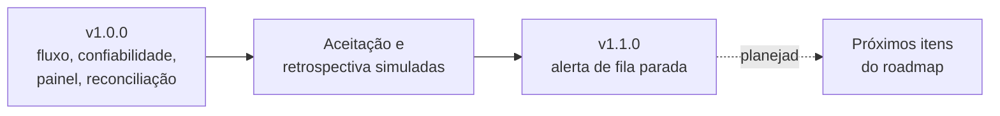

# 09 — Evolução e roadmap

Fase I: o que mudou depois da v1.0.0, o que foi aprendido e o que vem a seguir. Documentos de origem: [Episódio 6](../06-pos-lancamento/README.md).

[← Índice do ciclo de vida](README.md) · Anterior: [08 Implantação e operação](08-implantacao-e-operacao.md) · Início: [Índice](README.md)

## Histórico de versões

| Versão | Mudança | Impacto de compatibilidade | Testes (registro) |
|---|---|---|---|
| 1.0.0 | Primeira versão completa | — | 177 Vitest e 9 E2E |
| 1.1.0 | `GET /v1/admin/alerts`, banner no painel, `worker` em `/health`, `oldestPendingAgeSeconds` em `/metrics` | Aditiva; contrato da Ponte `1.0.0` → `1.1.0`; sem migração de banco | 193 Vitest e 10 E2E (2026-10-23, commit `fcf035d`); 193 Vitest reexecutados em 2026-10-24, commit `e960fbd` |

Detalhes: [CHANGELOG](../06-pos-lancamento/CHANGELOG.md).

## Solicitações de mudança e seus impactos

| Pedido | Origem | Decisão | Impacto |
|---|---|---|---|
| Alerta de fila parada | Responsável de TI (aceitação, simulada) | Implementado na v1.1.0 | Endpoint novo e campos opcionais; sem mudança de banco |
| Evento de liberação de conferência | Analista financeira | Roadmap, item 1 | Novo evento do ERP, novo tratador, contrato do ERP `1.1.0` |
| Dois segredos de webhook | Responsável de TI | Roadmap, item 2 | Verificação tenta o segredo novo e o antigo |
| Aviso ao vendedor na fila de falhas | Gerente comercial e analista | Roadmap, item 4 | Escrita no CRM; exige novo campo |

## Problemas identificados e ações corretivas

Os 12 itens do [registro de problemas](../05-qualidade/bugs-e-aprendizados.md) já foram corrigidos. Os pontos ainda abertos são limitações declaradas, não defeitos: pedido existente não é alterado, painel sem edição e sem tempo real, rotação de segredo com indisponibilidade curta ([limitações](../06-pos-lancamento/roadmap.md#limitações-conhecidas)).

## Lacunas identificadas nesta revisão do ciclo de vida

Itens que o repositório não cobre hoje e que não são tratados como funcionalidades existentes:

| Lacuna | Onde aparece | Tratamento sugerido |
|---|---|---|
| Sem workflow de CI | [06](06-desenvolvimento-e-configuracao.md#cicd-e-automações) | Workflow com PostgreSQL de serviço rodando `typecheck` e `test`, sem o E2E que regrava prints |
| Sem rotina de backup do banco da Ponte | [08](08-implantacao-e-operacao.md) | Definir antes de qualquer uso real |
| Sem política de retenção do `payload` | [05](05-modelo-de-dados.md#retenção-auditoria-privacidade-e-acesso) | Prazo de guarda e mascaramento de dados pessoais |
| Sem trilha de quem reprocessou | [05](05-modelo-de-dados.md#retenção-auditoria-privacidade-e-acesso) | Registrar o usuário na ação administrativa |

## Dívida técnica priorizada

| Prioridade | Item | Por que nesta ordem |
|---|---|---|
| 1 | CI automatizada | Protege a regressão que hoje depende de execução manual |
| 2 | Notificação ativa de alertas | O alerta atual depende de alguém consultar o painel (R-07 mitigado, não eliminado) |
| 3 | Reconciliação incremental | Só pesa com volume maior; o cenário atual é pequeno |
| 4 | Edição do mapeamento pelo painel | Conveniência: a API já existe |

## Roadmap

Fonte: [roadmap](../06-pos-lancamento/roadmap.md), com oito itens priorizados. Os três primeiros:

| Prioridade | Item | Justificativa registrada |
|---|---|---|
| 1 | Evento de liberação de conferência | Hoje o CRM só aprende que a cobrança foi liberada pela reconciliação (RN-12) |
| 2 | Aceitar dois segredos de webhook | Trocar o segredo recusa eventos por alguns minutos |
| 3 | Notificação ativa de alertas | O alerta depende de alguém olhar |

Fora do escopo desde o início: nota fiscal, sistemas reais, multiempresa, mensageria externa, cancelamento ou alteração de pedido e cobrança já criados.

## Lições aprendidas

- **Contrato antes do código** fez decidir códigos de erro e semântica de idempotência antes de ter pressa; o teste de contrato achou duas inconsistências reais.
- **Gravar antes de processar** eliminou uma classe de problemas (o "dual write").
- **Teste de tempo afirma piso, nunca teto**; relógios diferentes não se misturam.
- **Escrever o que não foi testado** impede prometer o que não foi medido.
- **Processo:** montar o isolamento de bancos por projeto antes do primeiro teste de integração teria poupado tempo (itens 7, 8, 11 e 12).

Fonte: [retrospectiva final](../06-pos-lancamento/retrospectiva-final.md).
