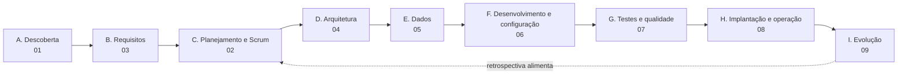
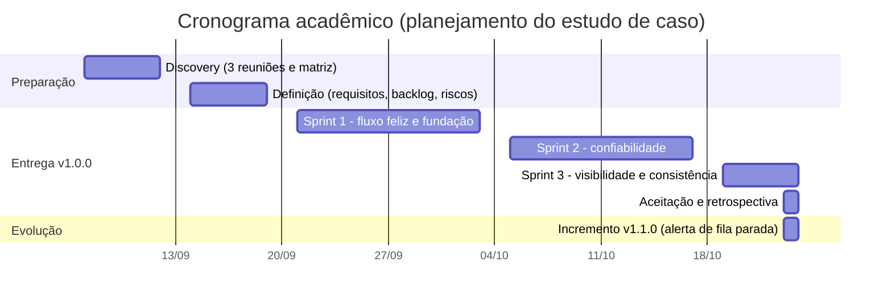
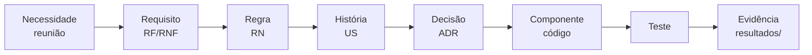

# Ciclo de vida do projeto

Relatório do ciclo de vida da Ponte, do problema de negócio à evolução do produto. Cada página cobre uma fase e aponta para os documentos de origem em `docs/`, sem repeti-los.

[← README](../../README.md) · [Guia da série](../INDEX.md) · [Glossário](../GLOSSARIO.md)

## Fases e documentos

| Fase | Página | Pergunta que responde |
|---|---|---|
| A | [01 Visão e discovery](01-visao-e-discovery.md) | Qual é o problema, para quem e dentro de quais restrições? |
| C | [02 Planejamento e Scrum](02-planejamento-e-scrum.md) | Em que ordem e com que critérios o produto foi entregue? |
| B | [03 Requisitos e rastreabilidade](03-requisitos-e-rastreabilidade.md) | O que o sistema precisa fazer e como cada requisito chega ao teste? |
| D | [04 Arquitetura e ADRs](04-arquitetura-e-adrs.md) | Como a restrição do ERP virou desenho e quais alternativas foram descartadas? |
| E | [05 Modelo de dados](05-modelo-de-dados.md) | Que dados sustentam idempotência, tentativas e reconciliação? |
| F | [06 Desenvolvimento e configuração](06-desenvolvimento-e-configuracao.md) | Como o código, os contratos e as versões foram geridos? |
| G | [07 Testes e qualidade](07-testes-e-qualidade.md) | O que foi provado, com que evidência e o que ficou sem prova? |
| H | [08 Implantação e operação](08-implantacao-e-operacao.md) | Como o produto seria implantado e operado, e o que existe de fato? |
| I | [09 Evolução e roadmap](09-evolucao-e-roadmap.md) | O que mudou depois da v1.0.0 e o que vem a seguir? |

Complementos: [reuniões](reunioes/README.md) · [sprints](sprints/README.md) · [catálogo de diagramas](diagramas/README.md).

## Linha do tempo

Dois calendários convivem aqui e não se misturam.

**Observado no Git.** Todos os commits e as duas tags estão em 2026-10-23, exceto os de documentação de apresentação, de 2026-10-24.

| Marco | Commit / tag | Data (Git) |
|---|---|---|
| Estrutura do monorepo | `3e34a50` | 2026-10-23 |
| Discovery e definição documentados | `809d63f`, `a320790` | 2026-10-23 |
| Arquitetura e contratos documentados | `b5aff6b`, `c8838b2` | 2026-10-23 |
| Núcleo da Ponte, CRM e ERP simples | `fa03086`, `afa6518`, `0bd9bbe` | 2026-10-23 |
| Falha injetada, painel e E2E | `76c6b79`, `c81d889`, `8aedca7` | 2026-10-23 |
| Qualidade e retrospectiva | `863279b`, `105a5c0` | 2026-10-23 |
| Versão **v1.0.0** | tag `v1.0.0` (`863279b`) | 2026-10-23 |
| Alerta de fila parada | `3bdf34f`, `fcf035d` | 2026-10-23 |
| Versão **v1.1.0** | tag `v1.1.0` (`21e6b8b`) | 2026-10-23 |
| Apresentação, glossário e README | PRs #1 e #2 | 2026-10-24 |

**Planejado no cenário acadêmico.** O cronograma abaixo organiza as fases em semanas para fins de estudo; as datas não são datas de commit, de release nem de execução de teste.

## Rastreabilidade em uma linha

A matriz completa, com 14 linhas, está em [rastreabilidade](../02-definicao/07-rastreabilidade.md) e é resumida na [página 03](03-requisitos-e-rastreabilidade.md).

## Nota de contexto acadêmico

O material integra um estudo de caso. A empresa, as pessoas, os dados e as reuniões são fictícios, e o cronograma, as sprints, as atas de planejamento e os papéis das páginas deste relatório foram elaborados para compor o cenário de aprendizagem. Código, testes, contratos, resultados de execução e histórico Git são observados e verificáveis.

Uso de IA: a construção do cenário (reuniões simuladas, atas e planejamento) e do código contou com apoio de IA, registrado no trailer de coautoria dos commits.
