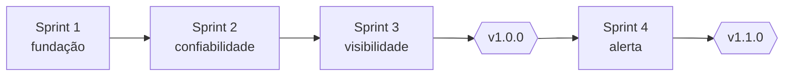

# Sprints

Quatro entregas: três sprints até a v1.0.0 e um incremento até a v1.1.0. Os objetivos e os itens vêm do [backlog](../../02-definicao/04-backlog-em-3-sprints.md); as revisões vêm de [05-qualidade](../../05-qualidade/sprint-1-review.md). As janelas de data são do cronograma acadêmico do estudo de caso e não correspondem a datas de commit.

[← Índice do ciclo de vida](../README.md) · [Planejamento e Scrum](../02-planejamento-e-scrum.md)

| Sprint | Objetivo | Histórias | Janela planejada | Commits de referência |
|---|---|---|---|---|
| [1](sprint-1.md) | Fluxo feliz e fundação | US-01 a US-04, US-10 (parte) | 2026-09-21 a 2026-10-02 | `feffb3e`, `afa6518`, `0bd9bbe`, `fa03086`, `0cb1a1b` |
| [2](sprint-2.md) | Confiabilidade | US-05 a US-07, US-13 | 2026-10-05 a 2026-10-16 | `76c6b79`, `2fcd89e`, `893eaa7` |
| [3](sprint-3.md) | Visibilidade e consistência | US-08, US-09, US-11, US-12 | 2026-10-19 a 2026-10-23 | `c81d889`, `e0ab64c`, `8aedca7`, `863279b` |
| [4](sprint-4-incremento-v1-1.md) | Alerta de fila parada | melhoria 1 da retrospectiva | 2026-10-23 | `3bdf34f`, `8497ba1`, `ff6e7ff`, `fcf035d`, `9d00c1b` |

Os commits seguem o histórico real do Git (todos em 2026-10-23). A associação entre commit e sprint é por tema do commit, já que o histórico não foi organizado sprint a sprint, como reconhece a [retrospectiva final](../../06-pos-lancamento/retrospectiva-final.md).
