# Galeria: o sistema em 17 telas

Cada tela é um print gerado pelo próprio sistema: o Playwright dirige as telas reais, sobre bancos limpos (roteiro em [`e2e/console.spec.ts`](../../e2e/console.spec.ts)). A galeria segue a ordem do fluxo, da venda ganha até a execução dos testes; por isso o 16 e o 17 (alertas da v1.1) aparecem antes do 15.

[← Índice da série](../INDEX.md) · [Glossário](../GLOSSARIO.md)

Cada legenda tem duas partes: **o que se vê** · **por que importa**.

## 1. A venda chega ao ERP

### 01 · CRM: negócio ganho
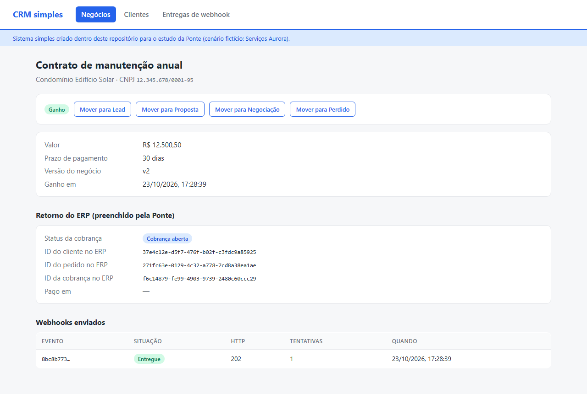

**O que se vê:** o negócio em **Ganho**, o bloco "Retorno do ERP (preenchido pela Ponte)" com status da cobrança e os IDs de cliente, pedido e cobrança, e a entrega do webhook com HTTP 202 e 1 tentativa. · **Por que importa:** o vendedor marca "Ganho" e o CRM envia o webhook `deal.won`; o retorno preenchido pela Ponte fecha o ciclo. O CRM envia uma vez e registra a entrega; se a Ponte estava fora, a entrega fica como falha e pode ser reenviada com o mesmo id de evento, o que a idempotência torna seguro.

### 02 · ERP: cobranças criadas
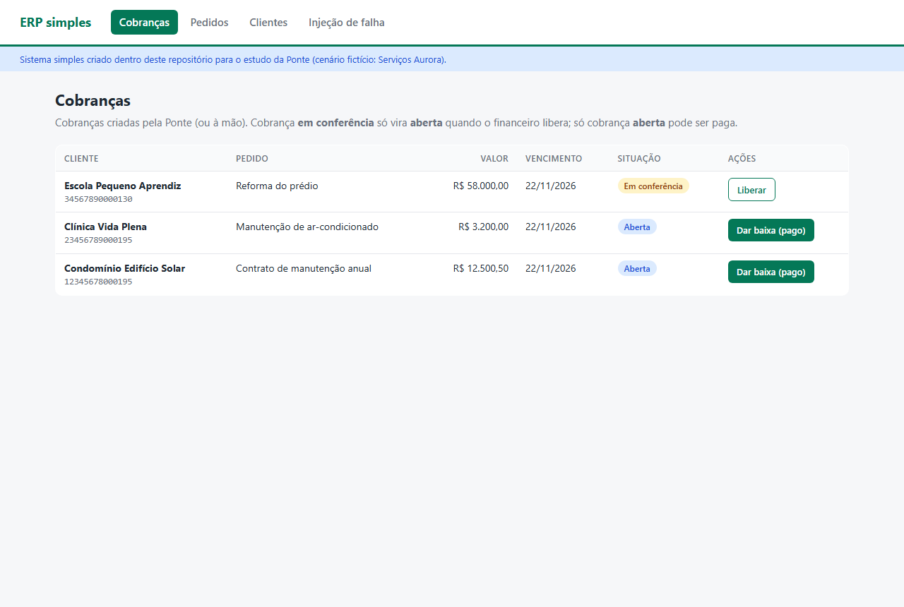

**O que se vê:** três cobranças; a de R$ 58.000,00 está **Em conferência** (botão "Liberar"), as outras duas estão **Abertas** (botão "Dar baixa (pago)"). · **Por que importa:** é a regra RN-06: a partir de R$ 50.000,00 o financeiro libera antes de a cobrança poder receber pagamento. A regra resolve a contradição entre comercial (rapidez) e financeiro (conferência) sem escolher um dos lados ([reunião 2](../01-discovery/04-reuniao-2-analista-financeira.md)).

### 03 · ERP: pedidos criados
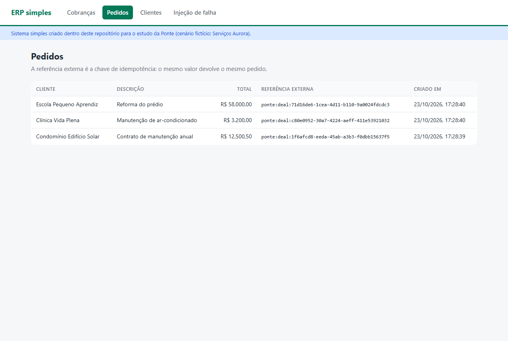

**O que se vê:** três pedidos com cliente, descrição, total e a **referência externa** (`ponte:deal:…`). · **Por que importa:** a referência externa é a chave de idempotência no ERP: o mesmo valor devolve o mesmo pedido ([ADR-003](../03-arquitetura/adr/ADR-003-idempotencia.md)).

### 04 · ERP: clientes criados
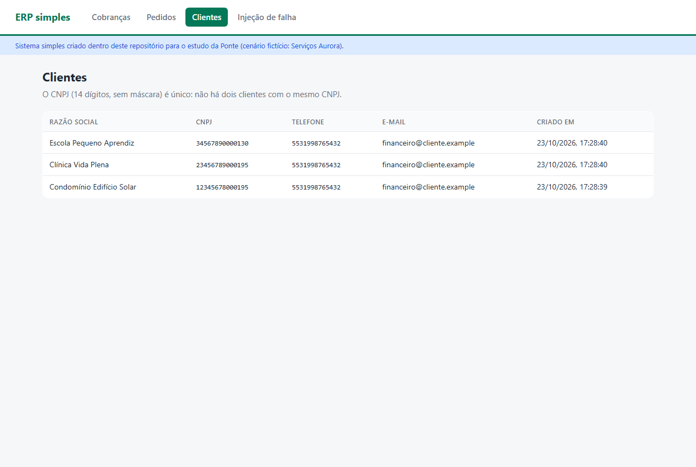

**O que se vê:** três clientes com CNPJ de 14 dígitos sem máscara, telefone `5531998765432` e e-mail. A tela informa que o CNPJ é único. · **Por que importa:** mostra a conversão de formato entre CRM (CNPJ com máscara, telefone livre) e ERP, descrita no [mapa de dados](../01-discovery/07-mapa-de-dados.md).

### 05 · CRM: cobrança paga
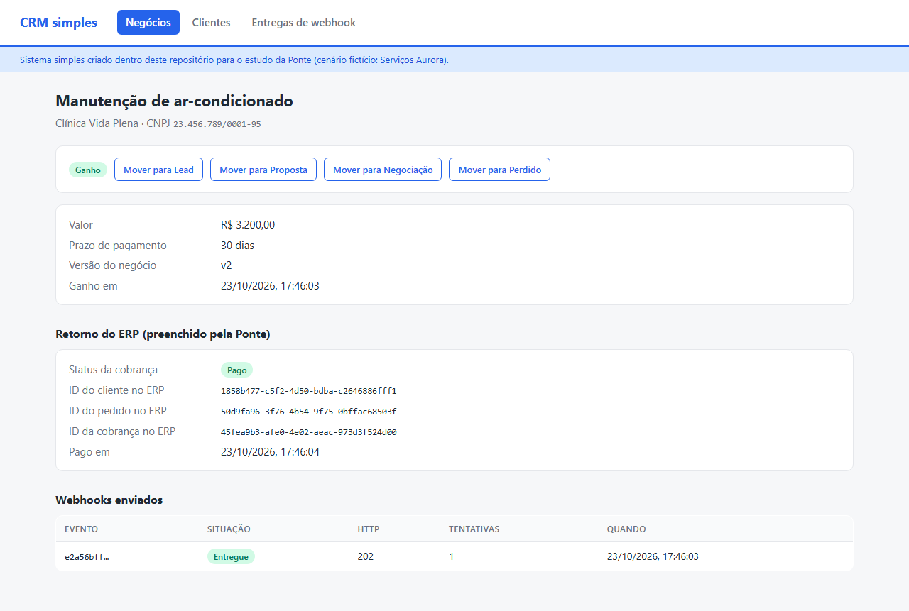

**O que se vê:** o status da cobrança em **Pago** e o campo "Pago em" preenchido. · **Por que importa:** depois da baixa no ERP, o webhook `invoice.paid` chega à Ponte e o CRM é atualizado. O ERP é a fonte de verdade do status da cobrança.

## 2. O painel acompanha a integração

### 06 · Painel: visão geral
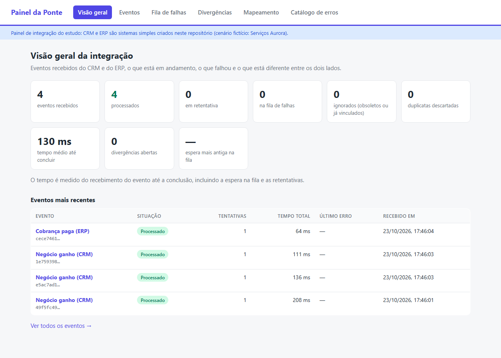

**O que se vê:** contadores (4 recebidos, 4 processados, 0 em retentativa, 0 na fila de falhas, 0 duplicatas, 0 divergências), tempo médio de 130 ms e a lista de eventos recentes. · **Por que importa:** o tempo é medido do recebimento do evento até a conclusão, incluindo a espera na fila e as retentativas. O painel só mostra e aciona pela API administrativa; a chave de administração fica no servidor do painel ([ADR-010](../03-arquitetura/adr/ADR-010-fastify-vs-next.md)).

## 3. O ERP cai

### 07 · ERP: modo de falha
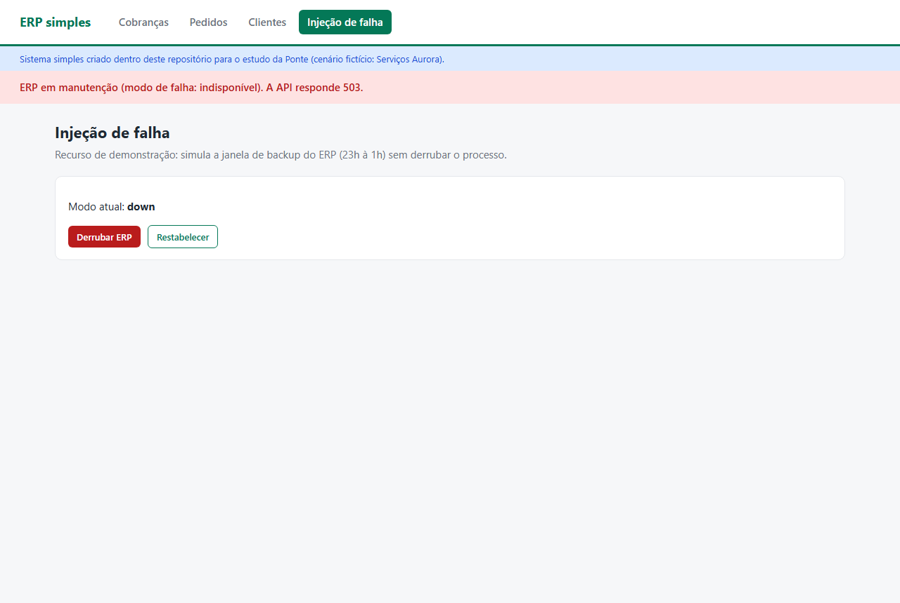

**O que se vê:** o ERP em modo `down`, com faixa vermelha informando que a API responde 503. A tela descreve o recurso como simulação da janela de backup (23h à 1h). · **Por que importa:** é a restrição da [reunião com TI](../01-discovery/05-reuniao-3-responsavel-de-ti.md) reproduzida na demonstração.

### 08 · Painel: evento em retentativa
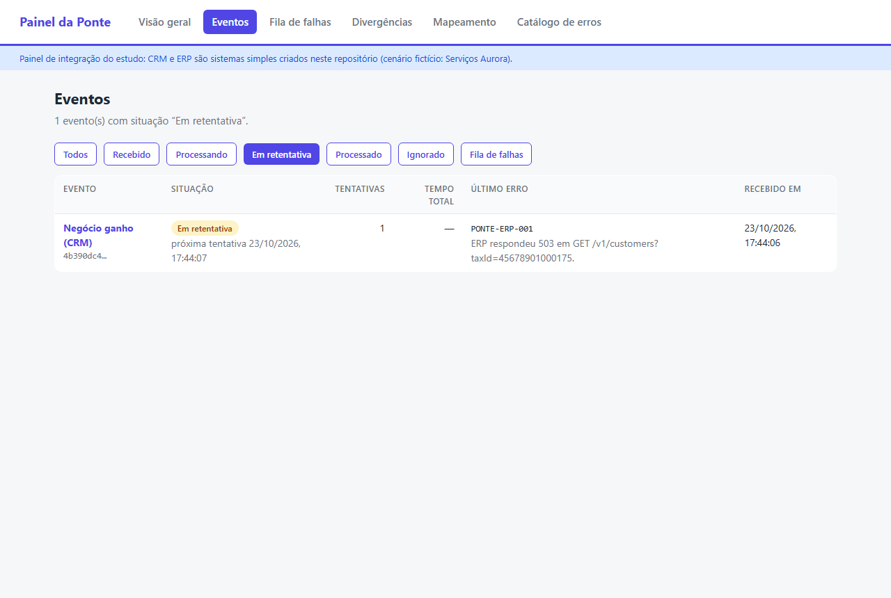

**O que se vê:** a lista de eventos filtrada por **Em retentativa**, com um evento, o erro `PONTE-ERP-001` ("ERP respondeu 503 …") e a hora da próxima tentativa. · **Por que importa:** falha temporária (rede, timeout, 5xx, 429) é retentada; falha permanente não ([ADR-004](../03-arquitetura/adr/ADR-004-retentativa-com-backoff.md)).

### 09 · Painel: tentativas e backoff
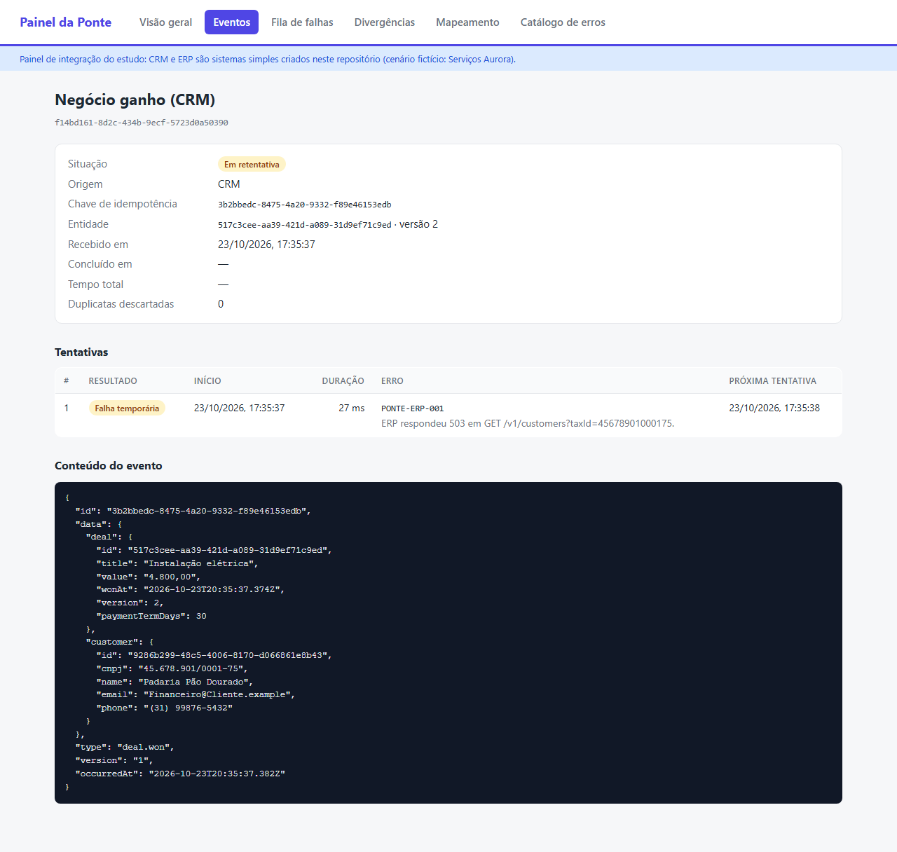

**O que se vê:** o detalhe do evento, com a chave de idempotência, a tabela de tentativas (tentativa 1, falha temporária, 20 ms, próxima tentativa às 17:46:06) e o conteúdo do evento. · **Por que importa:** cada tentativa fica registrada com erro, duração e hora da próxima, o que permite investigar sem abrir o log.

### 10 · Painel: fila de falhas
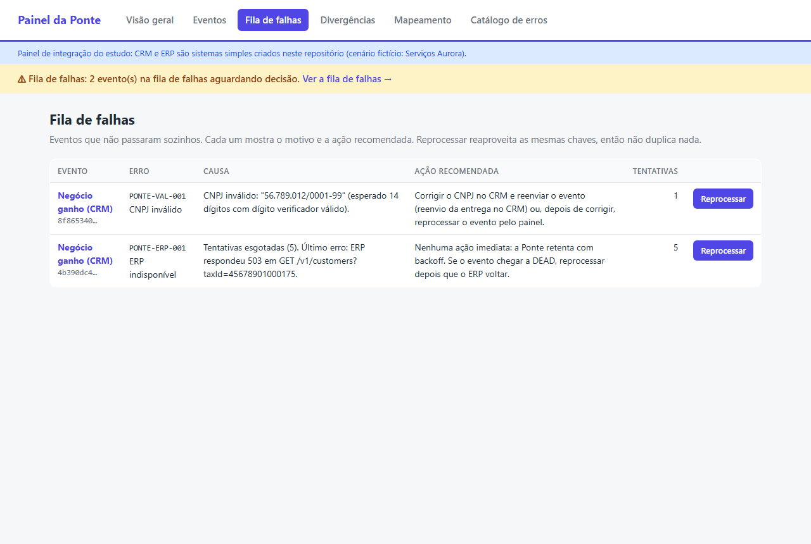

**O que se vê:** dois eventos: um com `PONTE-VAL-001` (CNPJ inválido, 1 tentativa) e um com `PONTE-ERP-001` (tentativas esgotadas, 5). Cada linha tem causa, ação recomendada e o botão **Reprocessar**. · **Por que importa:** erro de dado vai direto para a fila de falhas (dead-letter), sem retentativa; o outro esgotou as tentativas com o ERP fora ([ADR-005](../03-arquitetura/adr/ADR-005-fila-de-falhas.md)).

### 11 · Painel: reprocessamento
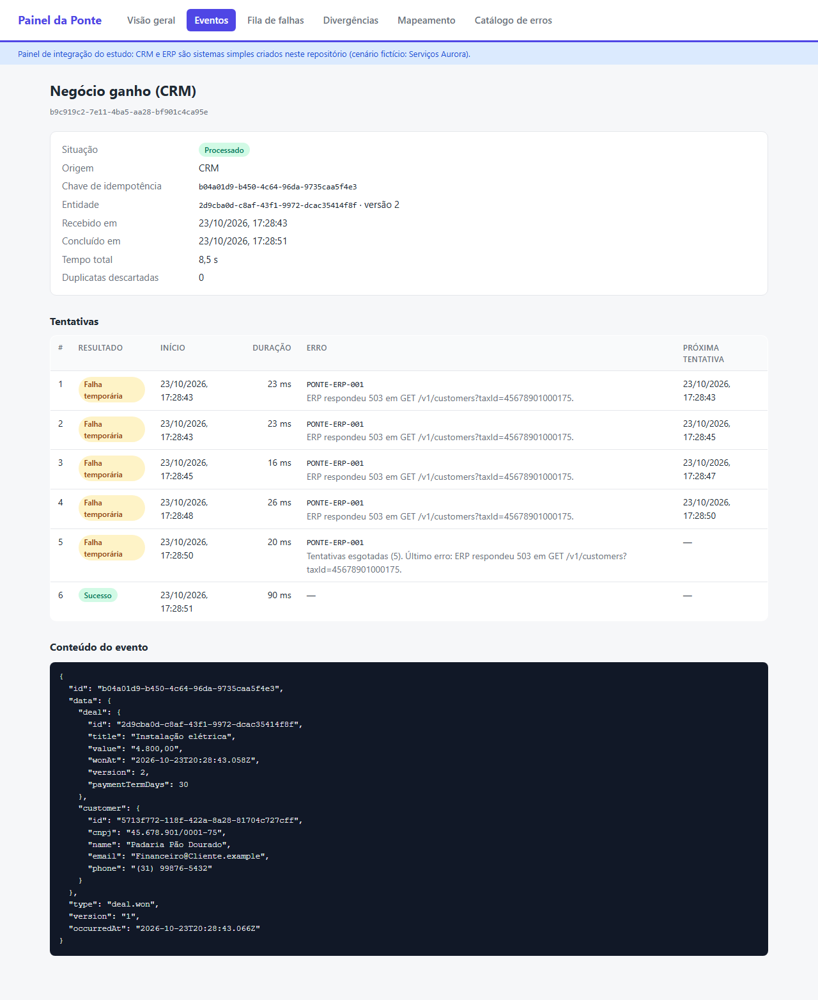

**O que se vê:** o mesmo evento da tela 09, agora **Processado**, com 6 tentativas (5 falhas temporárias e 1 sucesso) e tempo total de 8,4 s. · **Por que importa:** o reprocessamento é manual e reaproveita as mesmas chaves, então não duplica. Reprocessar automaticamente um erro de dado só repetiria o erro.

## 4. Os dois lados são comparados

### 12 · Painel: divergências da reconciliação
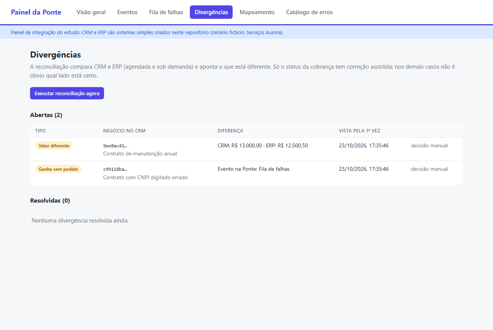

**O que se vê:** duas divergências abertas: **Valor diferente** (CRM R$ 13.000,00, ERP R$ 12.500,50) e **Ganho sem pedido** (evento na fila de falhas), ambas marcadas "decisão manual"; o botão "Executar reconciliação agora". · **Por que importa:** a reconciliação detecta e não corrige em silêncio; só o status da cobrança tem correção assistida ([ADR-006](../03-arquitetura/adr/ADR-006-reconciliacao.md)).

### 13 · Painel: mapeamento de campos
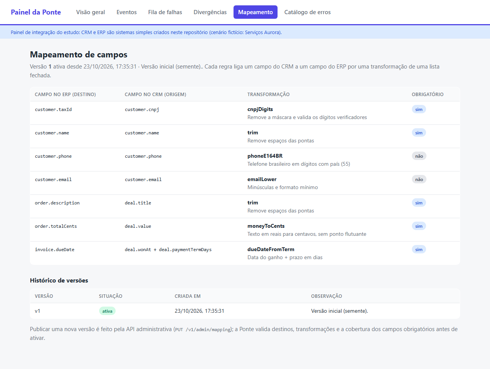

**O que se vê:** a versão 1 ativa e sete regras (destino no ERP, origem no CRM, transformação, obrigatório), como `cnpjDigits`, `moneyToCents` e `dueDateFromTerm`, mais o histórico de versões. · **Por que importa:** cada regra usa uma transformação de uma lista fechada; nada de código ou expressão vinda de configuração ([ADR-008](../03-arquitetura/adr/ADR-008-mapeamento-configuravel.md)).

### 14 · Painel: catálogo de erros
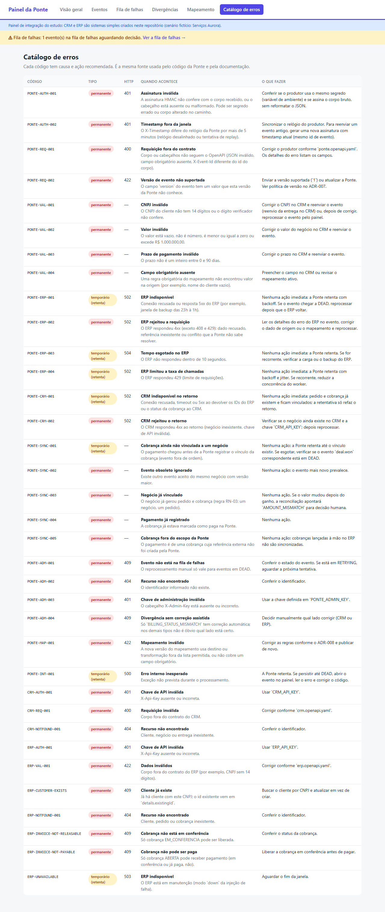

**O que se vê:** a tabela de códigos de erro (`PONTE-*`, `CRM-*`, `ERP-*`) com tipo, HTTP, quando acontece e o que fazer. · **Por que importa:** a tela diz que é a mesma fonte usada pelo código da Ponte e pela documentação; a versão em texto está no [catálogo de erros](../04-contratos-de-api/catalogo-de-erros.md).

## 5. Operação e prova

### 16 · Painel: alerta de fila parada (v1.1)
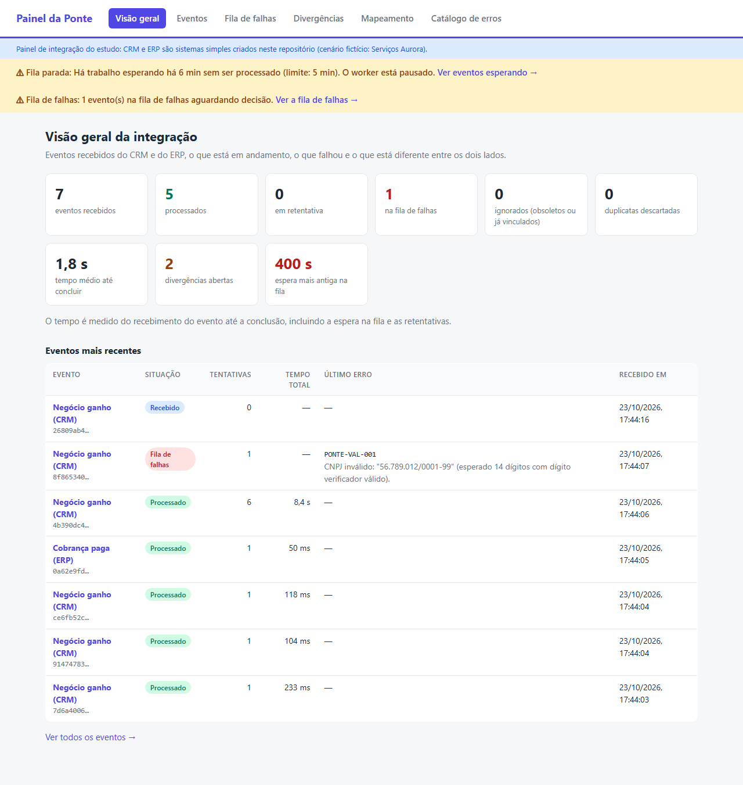

**O que se vê:** dois banners no topo ("Fila parada: há trabalho esperando há 6 min sem ser processado (limite: 5 min). O worker está pausado." e o da fila de falhas) e o cartão "espera mais antiga na fila" com 400 s. · **Por que importa:** veio da [retrospectiva](../06-pos-lancamento/retrospectiva.md); a decisão está no [ADR-012](../03-arquitetura/adr/ADR-012-alerta-de-fila-parada.md).

### 17 · Painel: alerta crítico de fila parada (v1.1)
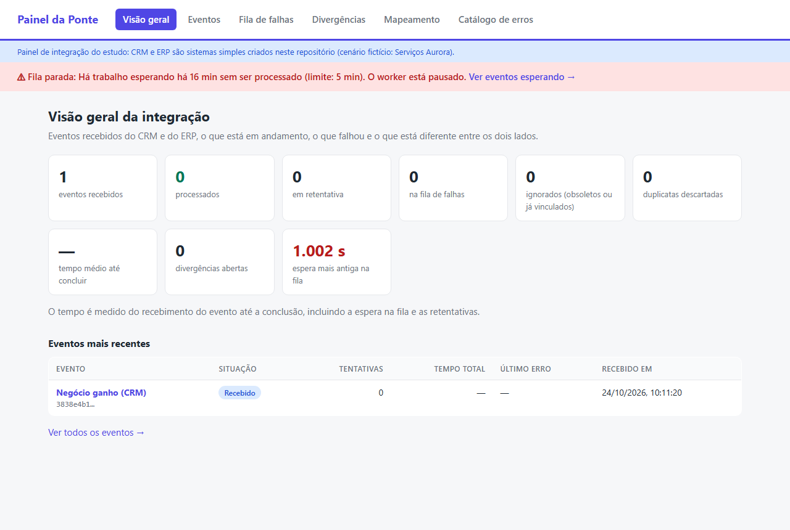

**O que se vê:** o banner em vermelho (nível crítico) com a espera de 16 min e o limite de 5 min, o cartão "espera mais antiga na fila" em 1.002 s e um evento "Negócio ganho (CRM)" ainda em **Recebido**, com 0 tentativas. · **Por que importa:** o alerta fica crítico a partir de 3× o limite (15 min), como descreve o [guia de operação](../06-pos-lancamento/guia-de-operacao.md#alertas-v11). O print foi gerado em 2026-10-24 com o worker pausado e o job marcado como vencido há cerca de 1.000 s, o mesmo recurso do roteiro E2E do print 16; não é uma espera real de 16 minutos.

### 15 · Execução dos testes
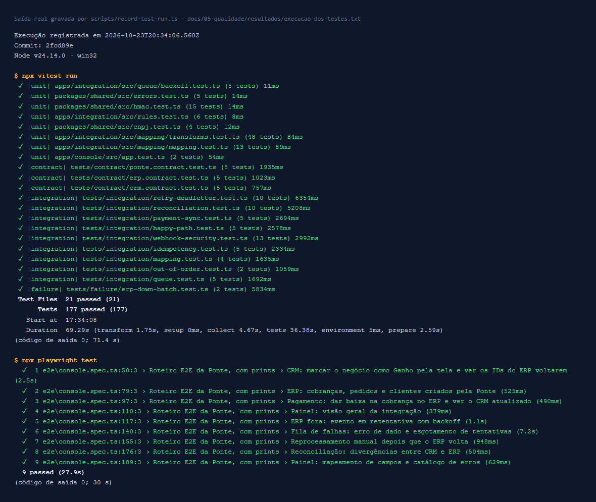

**O que se vê:** a saída do Vitest (23 arquivos, 193 testes) e do Playwright (10 testes), com o cabeçalho "Execução registrada em 2026-10-23T20:44:34.406Z · Commit fcf035d · Node v24.14.0". · **Por que importa:** é a renderização do arquivo [execucao-dos-testes.txt](../05-qualidade/resultados/execucao-dos-testes.txt), gravado por `npm run test:record`.

## Telas sem print

- CRM, aba **Clientes**.
- CRM, aba **Entregas de webhook** (o print 01 mostra só a tabela "Webhooks enviados" do negócio).
- Painel, **Eventos** nos outros filtros (o print 08 cobre só "Em retentativa").
